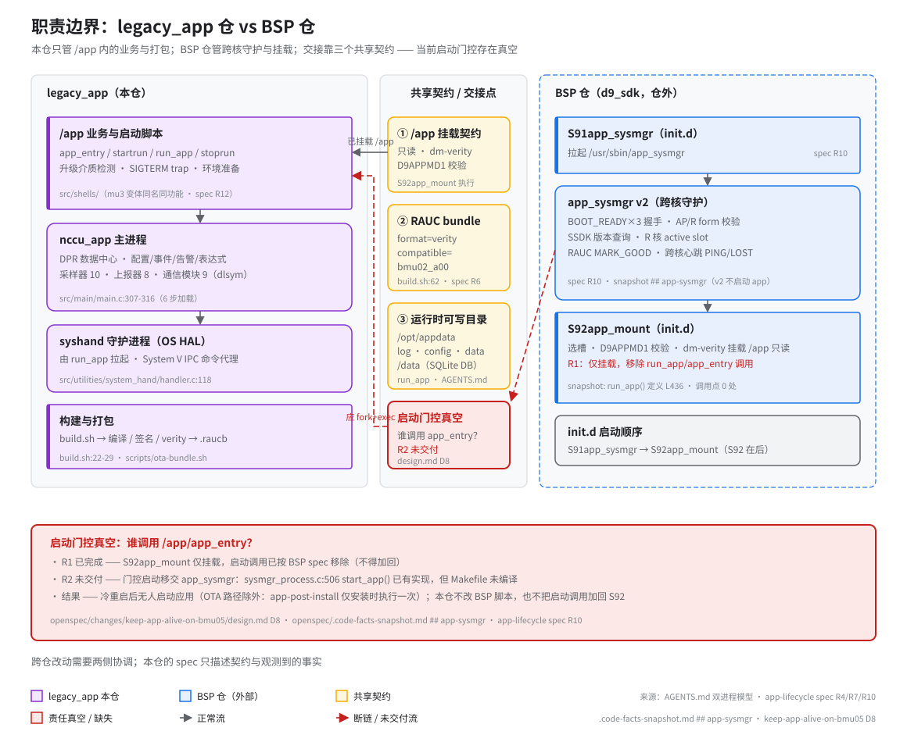

# 职责边界：legacy_app 仓 vs BSP 仓

> **性质**：叙述性文档
> **需求权威源**：`openspec/specs/app-lifecycle/spec.md`（R4 运行时 verity 挂载 / R7 启动链 / R10 app_sysmgr 契约）
> **代码事实基线**：`openspec/.code-facts-snapshot.md`
> **对应提交**：`86f803b5`
> **状态**：🟠 部分（结构完整；R2 交付后需回填启动门控状态）

本页回答一个问题：**改某处代码前，先确认它归哪个仓管。** 图中左侧是本仓（legacy_app）独占的领域，右侧是 BSP 仓（d9_sdk）独占的领域，中间是双方共同维护的交接契约。

## 谁负责什么

| 职责 | 归属仓 | 依据 |
|------|:--:|------|
| `/app` 内业务与启动脚本（`app_entry` / `startrun` / `run_app` / `stoprun`） | 本仓 | `src/shells/`；mu3 变体同名同功能（spec R12） |
| `nccu_app` 主进程（DPR / 采样器 10 / 上报器 8 / 通信模块 9） | 本仓 | `src/main/main.c:307-316`（6 步加载） |
| `syshand` 守护进程（OS HAL，System V IPC 命令代理） | 本仓 | `src/utilities/system_hand/handler.c:118` |
| 构建与打包（`build.sh` → 编译 / 签名 / verity → `.raucb`） | 本仓 | `build.sh:22-29`、`scripts/ota-bundle.sh` |
| `S91app_sysmgr` → `app_sysmgr`（跨核守护） | BSP 仓 | spec R10；`.code-facts-snapshot.md` `## app-sysmgr` |
| BOOT_READY×3 握手 / SSDK 版本与 AP-R form 校验 / R 核 active slot / RAUC `MARK_GOOD` / 跨核心跳 | BSP 仓 | spec R10 各 Scenario |
| `S92app_mount`（选槽 + `D9APPMD1` 校验 + dm-verity 挂载 `/app` 只读） | BSP 仓 | spec R4 范围说明；R7 |
| `init.d` 启动顺序（S91 → S92） | BSP 仓 | spec R10「与 app 启动链的边界」 |

注意两套心跳互不相干：`app_sysmgr` 的跨核心跳（AP↔R，PING/PONG）属 BSP；`syshand` 的应用心跳属本仓（spec R10 明确两者不得混用）。

### 读图指引

- 紫色（左列）= 本仓拥有的代码，可以直接改；蓝色虚线泳道（右列）= BSP 仓，本仓只读、不修改。
- 黄色（中带）= 双方共同维护的契约，任何一侧单方面改动都会破坏另一侧。
- 红色 = 当前状态异常：M4 节点与红虚线表示「本应存在但未交付」的启动流（R2），底部红框给出完整因果链。
- 每个节点下方的淡色小字是 `file:line` 或文档出处，结论均可回溯到代码或 spec。

## 两条启动路径，一个入口

无论哪条路径，最终都汇聚到同一入口 `/app/app_entry /app`（其后是 `startrun → run_app → syshand + nccu_app`，见 spec R7）：

| 路径 | 谁调用 `app_entry` | 现状 |
|------|------|------|
| 冷重启 | 设计上由 BSP `app_sysmgr` 门控启动（R2） | **未交付**（源码在、未编译）→ 真空 |
| OTA | BSP `/usr/lib/rauc/app-post-install`（安装时执行） | **可用**（唯一在工作的启动钩子） |

因此本仓验证新版本时，走 OTA 安装路径可以正常拉起；而裸冷重启的板子会停在「挂载完成但无人启动」的状态。这不是本仓脚本的问题，改本仓侧启动链无法修复它。

### 表格未列出的间接依赖

- **HAL 6 函数**（`comm_port.h:284-291`）：本仓定义、本仓消费，是 9 个通信模块的统一接口——纯内部契约，不涉及 BSP。
- **配置 DB `System.cfg`**：随 `/app` 分区下发（本仓打包），运行时被复制到 `/opt/appdata/config/`（本仓 `run_app` 幂等复制）——数据流全程不出仓，但依赖契约 1 的挂载与契约 3 的目录存在。
- **平台变体宏（`-DIMMU3`）与 `src/shells/mu3/`**：本仓内部的双文件机制（spec R12 要求 mu3 与主脚本功能一致），不涉及 BSP。

## 三个交接契约

1. **`/app` 挂载契约** —— BSP 的 `S92app_mount` 完成选槽、`D9APPMD1` 元数据校验与 dm-verity 只读挂载；本仓所有脚本与二进制都假设运行于挂载好的只读 `/app` 内（spec R4、R7）。本仓只负责产出**能通过校验**的镜像，不干预挂载过程。
2. **RAUC bundle 格式** —— 本仓 `build.sh` 产出 verity 格式 bundle，`compatible=bmu02_a00` 必须与设备端 RAUC 配置一致（`build.sh:62`、spec R6）。BSP 侧的 `app-post-install` 在安装时执行（这是当前 OTA 路径能拉起应用的唯一钩子）。
3. **运行时可写目录约定** —— `/opt/appdata/{log,config,data}` 与 `/data`（SQLite DB 所在地，由 `NCCU_DATA_PATH` 决定）。目录由本仓 `run_app` 创建，但 `/opt/appdata` 是 bind mount、`/data` 是独立分区，其存在性由 BSP 的 rootfs 与分区表保证（见 AGENTS.md「运行时可写目录」）。

## 当前的边界缺口：启动责任真空

**谁调用 `app_entry`？** 答案目前是「冷重启路径上没人」：

- **R1 已完成**（BSP 在途变更 `add-system-mgmt-service`）：`S92app_mount` 的 `run_app` / `app_entry` 调用已按设计移除——函数体还在（`/etc/init.d/S92app_mount:436` 定义，`:454-456`），但全文件**调用点 0 处**。这是预期行为，**不得加回**。
- **R2 未交付**：门控启动职责移交给 `app_sysmgr`，BSP 源码 `sysmgr_process.c:506 start_app()` 已有实现（含退避重启），但 **Makefile 未编译**——现役 v2 二进制中 `app_entry` 的 `strings` 匹配数为 0。
- **结果**：冷重启后经 S91（不启动）、S92（只挂载）后无人启动应用；OTA 路径除外（`app-post-install` 仅安装时执行一次）。完整证据链见 `../../openspec/changes/keep-app-alive-on-bmu05/design.md` 的 **D8**。

本仓对此的态度：**不改 BSP 脚本，也不把启动调用加回 S92**——「不存在两个启动者」是 BSP spec 定下的原则；真空的修复由 BSP 交付 R2 完成，本仓侧对应的进程监管设计见同一变更的 `design.md`。

## 改代码时的判断规则

- 动 `/app` 内的脚本、`nccu_app`、`syshand`、`src/` 下任何东西 → **本仓**，直接改，跑 `./build.sh` 验证。
- 动 `init.d` 脚本（S91/S92）、挂载逻辑、分区与 RAUC 系统配置 → **BSP 仓**，本仓不改；发现问题在本仓 openspec 立项记录后与 BSP 协调。
- 动三个交接契约（`D9APPMD1` 元数据格式、bundle manifest、可写目录路径）→ **两侧协调**，先改本仓 spec（R5/R6/R7），再与 BSP 对齐设备端实现。
- 拿不准归属时 → 查 `openspec/.code-facts-snapshot.md`：标注「本子系统此前零覆盖」或「属 BSP 仓」的条目，都属于跨仓协调范畴。
