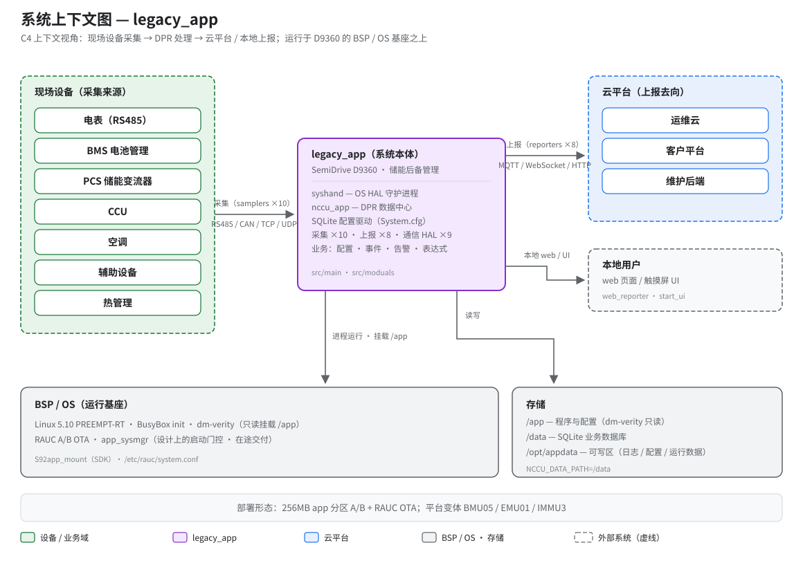

# legacy_app 是什么 — 系统定位一页看懂

> **性质**：叙述性文档
> **需求权威源**：暂无（叙述类，汇总自 `openspec/specs/` 与 `AGENTS.md`）
> **代码事实基线**：[`openspec/.code-facts-snapshot.md`](../../openspec/.code-facts-snapshot.md)
> **对应提交**：`86f803b5`
> **状态**：🟠 部分

## 图

读图指引：中间紫色块是本仓库交付的系统本体；左侧绿色虚线框是现场设备（数据从哪来）；
右侧蓝色虚线框是云平台（数据到哪去）；灰色带是它脚下的 BSP/OS 运行基座与可写存储；
右下角虚线框是本地使用者的入口。数字（采样 ×10、上报 ×8、通信 HAL ×9）均出自代码事实快照；
箭头上的通道与协议（RS485 / CAN / TCP / UDP、MQTT / WebSocket / HTTP）对应快照 `## comm-ports` 一节中实际编译的 9 个通信模块。

## 这是什么

`legacy_app` 是运行在 **SemiDrive D9360**（aarch64）上的**储能后备管理系统 App 层业务程序**。
在一台储能后备设备里，它把 BMS、PCS、电表、空调等现场设备的数据采集上来，在本地完成
配置驱动的状态计算、事件与告警判断，再按业务需要上报到云端或呈现给本地界面。
设备上它以两个进程的形态存在：`syshand`（OS 系统调用抽象守护，System V IPC）与
`nccu_app`（业务主进程，内部含 DPR 数据中心），由 `/app` 只读分区内的脚本链
`app_entry → startrun → run_app` 拉起。本仓库只覆盖 App 层；内核、根文件系统与
分区管理由 BSP/SDK 提供。它的启动与保活现状（冷重启真空、无进程监管）是已知问题，
详见 boot-chain 文档，不在本文展开。

## 业务域

- **域**：储能后备管理 —— 市电异常时保障关键负载供电的储能系统的设备侧管理程序。
- **对接的设备角色**：BMS（电池）、PCS（储能变流器）、CCU、电表（RS485）、空调、辅助设备、热管理。
- **核心数据流**：采集（samplers）→ 处理（DPR 数据中心：配置 / 事件 / 告警 / 表达式）→ 上报（reporters）。
- **配置驱动**：设备行为由 SQLite 配置库决定，而非编译期写死——`System.cfg` 含
  4157 个 DeviceModel、1958 个状态量、1119 条告警、5205 条 i18n 文案（`openspec/config.yaml`）。
- **上报去向**：运维云、客户平台、维护后端，以及本地 web / 触摸屏 UI
  （reporters 8 个逻辑模块，见快照 `## reporters`）。

## 技术形态

| 维度 | 事实 |
|---|---|
| 语言 / 架构 | C99 · aarch64（SemiDrive D9360） |
| OS | Linux 5.10 PREEMPT-RT · BusyBox init（无 systemd） |
| 运行时 | 双进程：`syshand`（OS HAL）+ `nccu_app`（业务主进程） |
| 可加载模块 | 通信 HAL ×9 · 采样器 ×10 · 上报器 ×8（`src/Makefile`，见快照各节） |
| 配置 | SQLite（`System.cfg`），**非 INI 文件** |
| 交付形态 | 256MB app 分区 A/B · dm-verity 只读 · RAUC OTA bundle（`./build.sh`） |
| 平台变体 | BMU05 / EMU01 / IMMU3（`-DIMMU3` 编译宏 + `src/shells/mu3/` 脚本变体） |

运行时可写位置只有三处：`/data`（SQLite 业务库）、`/opt/appdata`（日志 / 配置 / 运行数据）、
tmpfs 临时文件；`/app` 分区经 dm-verity 校验后只读挂载，运行期不可写。

## 与 BSP 的边界

一句话：**BSP/SDK 负责把 `/app` 分区选槽、验签并只读挂载好（以及设计上的启动门控），
本仓库负责挂载之后发生的一切业务**——启动链上的真空与断层不属于本仓库代码，
边界细节见 [`../10-architecture/boot-chain.md`](../10-architecture/boot-chain.md)
与 [`scope-and-boundaries.md`](scope-and-boundaries.md)。

## 阅读下一步

- [`glossary.md`](glossary.md) — 术语表：BMU / PCS / CCU / DPR / sampler / reporter / HAL / DAI / RAUC / dm-verity
- [`../10-architecture/boot-chain.md`](../10-architecture/boot-chain.md) — 从上电到业务就绪的完整启动链（4 张图）
- [`../20-features/README.md`](../20-features/README.md) — 采集 / 处理 / 上报 / 通信 / 平台管理五大功能域摘要

---

*本文为叙述性文档，不包含 MUST/SHALL 级需求断言；模块数与配置量等数字的权威出处为
`openspec/.code-facts-snapshot.md` 与 `openspec/config.yaml`，引用时以上述「对应提交」为准。*
