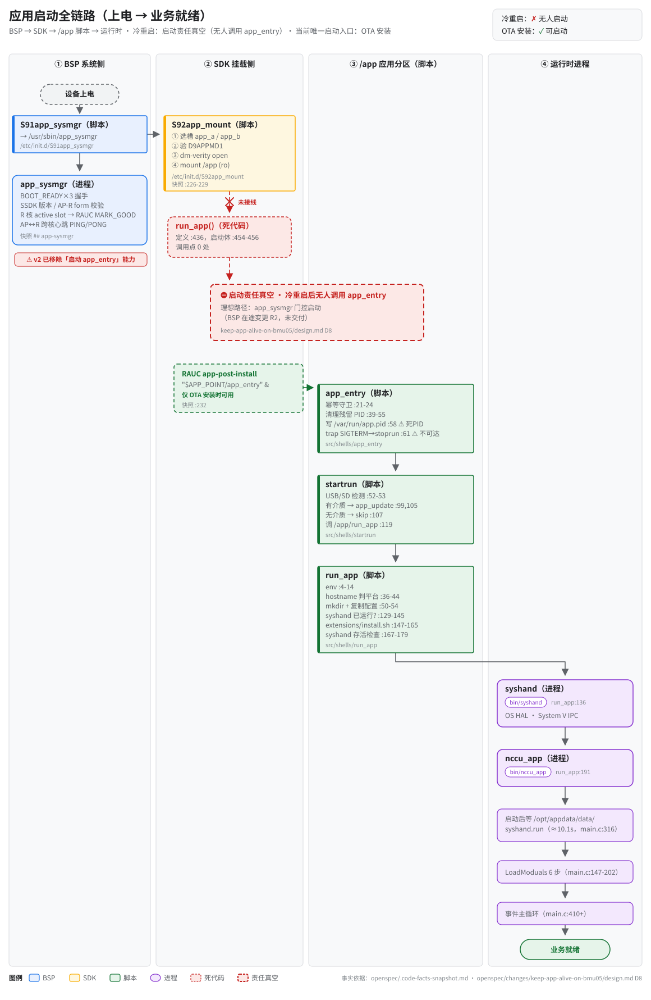
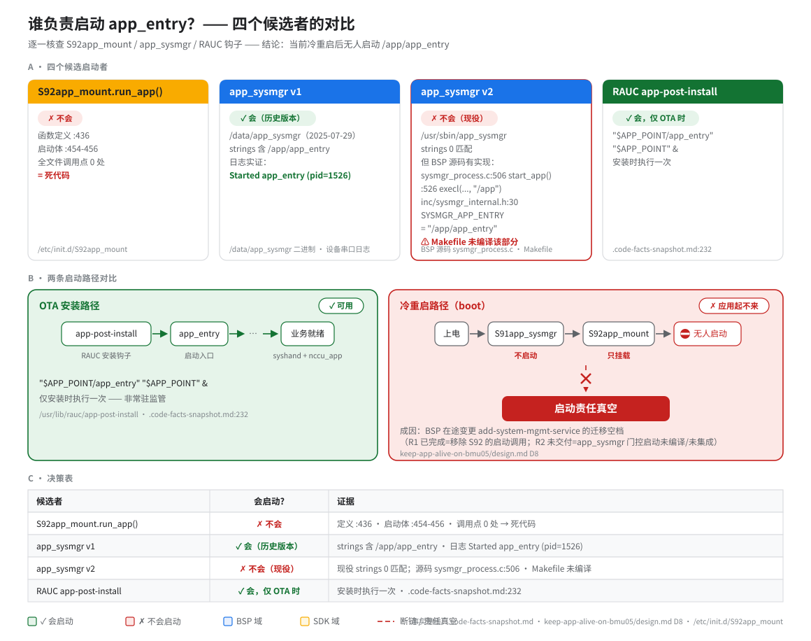
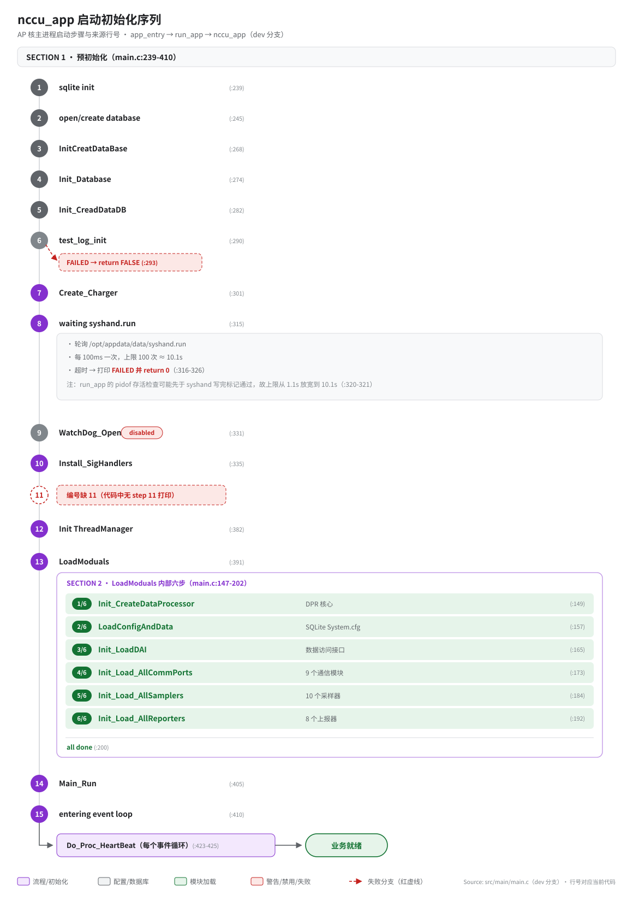
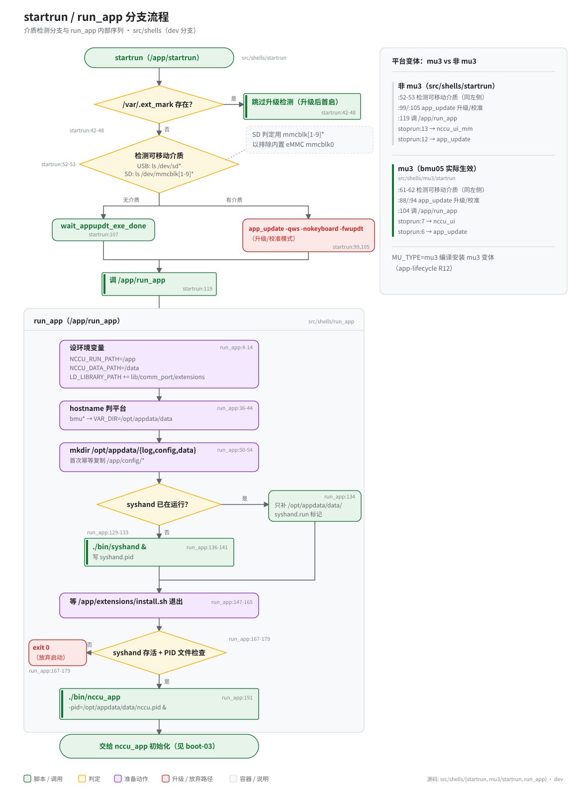

# 应用启动链（Boot Chain）

> **性质**：叙述性文档（读图指引 + 扩展说明）
> **需求权威源**：[`openspec/specs/app-lifecycle/spec.md`](../../openspec/specs/app-lifecycle/spec.md)（R7 运行时启动链 / R8 初始化序列 / R9 优雅停止 / R10 app_sysmgr 契约）
> **代码事实基线**：[`openspec/.code-facts-snapshot.md`](../../openspec/.code-facts-snapshot.md)（`## app-lifecycle`、`## app-sysmgr` 两节）
> **对应提交**：`2e266e1c`
> **状态**：🟠 部分

## 读图顺序

四张图按因果顺序排列：先看全链路，再看断点归因，最后是两段执行细节。

| 图 | 回答什么问题 | 何时看 |
|---|---|---|
| [图 1 · 应用启动全链路](svg/boot-01-power-on-chain.svg) | 从上电到业务就绪经过哪几层？哪一环断了？ | 第一次了解启动链，或做全链路定位 |
| [图 2 · 谁负责启动](svg/boot-02-start-ownership.svg) | 四个候选启动者各自行不行？真空是怎么形成的？ | 排查"冷重启后应用起不来" |
| [图 3 · nccu_app 初始化](svg/boot-03-nccu-init.svg) | 主进程内部按什么顺序初始化？日志停在哪个 step？ | 启动卡住、等 `syshand.run` 超时 |
| [图 4 · startrun / run_app 分支](svg/boot-04-startrun-branch.svg) | 有升级介质时启动走哪条岔路？mu3 变体差在哪？ | SD/USB 误触发升级、平台变体差异 |

---

## 图 1 · 应用启动全链路

- 三层接力，归属三个不同的仓：BSP 侧 `S91app_sysmgr` 拉起跨核守护 `app_sysmgr`（握手、槽位、心跳），SDK 侧 `S92app_mount` 选槽验签后只读挂载 `/app`，启动本体是 `/app` 分区里的脚本链 `app_entry → startrun → /app/run_app`，最终由 `run_app` 拉起 `syshand` 与 `nccu_app`（run_app 不被跳过）。三层改动都涉及跨仓协调，BSP 件暂无主仓需求覆盖，见快照 `## app-sysmgr` 的待办说明。
- ⛔ 断点只存在于冷重启路径：系统侧跑完 S91/S92 后无人调用 `app_entry`。OTA 路径（RAUC `app-post-install`）恰好绕开这个断点，所以现场才有"装完能跑、整机重启失效"的反差。
- boot 与 OTA 共用唯一入口 `app_entry`，入口之后行为一致，图 1 的下半段对两条路径通用。
- 节点旁的 `file:line`（如 `run_app:191`）指设备上已安装的脚本，来源仓库路径见各节点的来源小字。

## 图 2 · 谁负责启动

- 真空成因是 BSP 在途变更 `add-system-mgmt-service` 的迁移空档，一半已落地、一半未交付：**R1**（`S92app_mount` 仅挂载、移除启动调用）已生效，图里 `run_app()` 死代码是预期残留，不要加回去；**R2**（改由系统管理服务门控启动）源码已写好但 Makefile 未编译，等于新启动者还没接上。
- 常见误读：S91 槽位已被 BSP 的 `S91app_sysmgr` 占用，挂载脚本因此改编号为 `S92app_mount`。旧文档写的 `S91app_mount` 指的就是挂载脚本，这个文件名在设备上已不存在。
- 两套心跳别混淆：`app_sysmgr` 的 AP↔R 跨核心跳（PING/PONG）与 syshand 的应用级心跳（180s 阈值）是独立机制，边界说明见 spec R10；应用心跳行为本身见 [system-hand spec](../../openspec/specs/system-hand/spec.md)。

## 图 3 · nccu_app 初始化

- 串口日志打印的预初始化步骤号是 **1 到 15、缺 11**（代码中无 step 11 打印，`src/main/main.c:239-410`）。本文旧版与部分材料写"16 步预初始化"，引用计数时以串口打印为准；功能语义仍可对照 spec R8 的步骤表。
- 等 `syshand.run` 标记发生在 nccu_app 进程内部（`main.c:316` 起轮询），不是 shell 层等待；上限约 10.1s，放宽是因为 `run_app` 的 pidof 存活检查可能抢在 syshand 写完标记之前通过。
- 之后进入 `Main_LoadModuals` 六步加载（`main.c:147-202`）：DPR 核心 → SQLite 配置 → DAI → 通信模块 → 采样器 → 上报器。任何一步失败都是同一模式：记日志、进程退出，没有部分降级。
- 六步各自的验收语义分别归 comm-ports / samplers / reporters 三个 spec，本文不重复。

## 图 4 · startrun / run_app 分支

- SD 判定用 `ls /dev/mmcblk[1-9]*` 而不是 `mmc*`，为的是排除内置 eMMC `mmcblk0`（2026-07 的误检修正，记录在 spec R7 的升级介质检测 Scenario）。USB 判定仍是 `/dev/sd*`。
- 平台变体双实现并存：`src/shells/startrun`（非 mu3）与 `src/shells/mu3/startrun`，构建时 `MU_TYPE=mu3` 安装 mu3 变体，bmu05 实际运行 mu3。两者行号不同但逻辑同构，stoprun 的对应关系见图右侧面板；变体一致性归 spec R12。
- `run_app` 对 syshand 做存活 + PID 文件检查，失败时 `exit 0` 直接放弃启动：链路里没有重试者，这一退就是终局，也是"需要进程监管"的直接论据。

## 已知限制

- **冷重启后无人启动应用**（图 1 的 ⛔、图 2 的结论）：修复在 BSP 侧集成 R2；本仓承接的进程监管设计见 [`keep-app-alive-on-bmu05/design.md`](../../openspec/changes/keep-app-alive-on-bmu05/design.md)。
- **`app_entry` 的 SIGTERM trap 不可达**（spec R9 已标注）：脚本写完 PID、注册 trap 后调 `startrun` 即退出，syshand 与 nccu_app 早已后台化，trap 随 shell 一起消失。
- **`/var/run/app.pid` 是死 PID**：写入的是脚本自身的 `$$`，脚本一退即失效；停止操作应直接使用 `/opt/appdata/data/{syshand,nccu}.pid`。

## 维护

图源文件在 [`svg/`](svg/)，风格遵循 [`docs/_meta/svg-style.md`](../_meta/svg-style.md)；改动 `src/shells/` 下脚本时复核图中 `file:line`，并同步更新头部「对应提交」。
