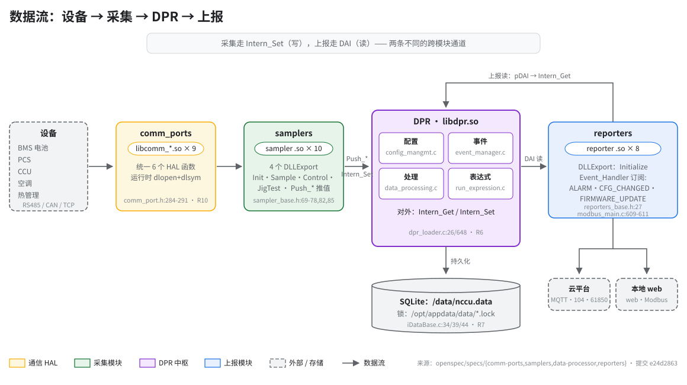

# 数据流（Data Flow）

> **性质**：叙述性文档（读图指引 + 扩展说明）
> **需求权威源**：[`openspec/specs/samplers/spec.md`](../../openspec/specs/samplers/spec.md)、[`openspec/specs/reporters/spec.md`](../../openspec/specs/reporters/spec.md)、[`openspec/specs/data-processor/spec.md`](../../openspec/specs/data-processor/spec.md)、[`openspec/specs/comm-ports/spec.md`](../../openspec/specs/comm-ports/spec.md)
> **代码事实基线**：[`openspec/.code-facts-snapshot.md`](../../openspec/.code-facts-snapshot.md)（`## comm-ports`、`## samplers`、`## reporters`、`## publib` 各节）
> **对应提交**：`e24d2863`
> **状态**：🟠 部分

## 图

## 读图顺序

一张图，三条看图动线，与代码中的调用方向一致：

| 步骤 | 看哪里 | 回答什么问题 |
|---|---|---|
| 1. 写路径（左→右） | 设备 → `comm_ports` → `samplers` → `Intern_Set` 入 DPR | 一帧设备数据怎么变成内存里的参数值？ |
| 2. 读路径（顶部绕行） | `reporters` → `pDAI` → `Intern_Get` 回 DPR | 上报器怎么拿到要上送的数据？ |
| 3. 持久化（DPR 下方） | DPR → SQLite `/data/nccu.data` | 断电前数据落在哪？锁文件在哪？ |

各节点旁的 `file:line` 是结论出处；模块数（9 / 10 / 8）的核对基线见快照 `## comm-ports`（9 个全编译）、`## samplers`（10 个编译）、`## reporters`。

## 补充说明

- **DPR 是枢纽，因为模块间不直连**：10 个采样器与 8 个上报器互相不引用对方，所有跨模块数据交换都经 `libdpr.so` 的内存态数据中心完成；DPR 同时负责配置装载（SQLite `System.cfg`，`config_mangmt.c`）、事件分发（`event_manager.c`）、处理主循环与表达式/告警运算（`data_processing.c` / `run_expression.c`），对应 [data-processor spec](../../openspec/specs/data-processor/spec.md) 的 **R1–R6**。

- **写路径与读路径是两条独立通道**：采集侧调用 `Push_VarValue` / `Push_BlobValue`（`sampler_base.h:82/85`）落入 `Intern_Set`（`dpr_loader.c:648`），上报侧经 `pReporter->pDAI->Get`（`handle_frame.c:151` 等）走 DAI 中间层转 `Intern_Get`（`dpr_loader.c:26`）——两者在装载期绑定到 `pThis->Set` / `pThis->Get` 函数槽（`dpr_loader.c:1486-1487`），图中所有跨框箭头最终都落在这一对函数上。图中刻意没画两条反向通道：采样器的下行控制 `Control`（`sampler_base.h:70`）与上报器的回写 `pDAI->Set(DAITYPE_CTRL_PARAMVALUE_RW)`，控制面语义见 [samplers spec](../../openspec/specs/samplers/spec.md) **R2/R3**；DAI 建立于六步加载第 3 步（`src/main/main.c:165`），数据面辅助函数见 samplers spec **R4**、跨模块访问见 data-processor spec **R6**。

- **事件是 DPR 内置的发布/订阅机制**：`Intern_Set` 带 `SETTYPE_SENDMSG` 时触发 `HandleEvent`（`dpr.h:52`），按各模块的订阅表回调 `Event_Handler`；以 `modbus_reporter` 为例，订阅表声明了 `EVENT_TYPE_ALARM` / `EVENT_TYPE_CFG_CHANGED` / `EVENT_TYPE_FIRMWARE_UPDATE` 三类（`modbus_main.c:609-611`），函数本体在 `modbus_main.c:17`。也就是说告警、配置热更新、固件升级通知都不走轮询，而是 DPR 主动推送。

- **DB 与锁文件分居两处，是刻意为之的布局**：四个 SQLite 库（`nccu.data` / `AppLog.data` / `BmsRunData.data` / `CloudData.data`）都在 `/data/` 顶层，而它们的 `flock` 锁文件（`.{applog,bmsrundata,clouddata}.lock`）在 `/opt/appdata/data/`（`iDataBase.c:34/39/44`）。`/opt/appdata` 是 bind mount（源 `/data/rootfs/opt/appdata`），与 `/data` 同分区但不同目录，所以**不要**在 `/opt/appdata/data/` 下找 `nccu.data`——它不存在；数据库安全语义见 data-processor spec **R7**。

- **加载次序即六步，模块数量由配置决定**：进程按 DPR 核心 → SQLite 配置 → DAI → 通信模块 → 采样器 → 上报器六步加载（`Main_LoadModuals`，`src/main/main.c:147-202`），任一步失败即记日志退出，没有部分降级；其中第 2 步从 SQLite `System.cfg` 解析模块清单（`Cfg_Parse_Sampler` / `Cfg_Parse_Reporter` / `Cfg_Parse_CommPort`，`dpr.h:24-27`），运行时按配置逐个 `dlopen`——编译数只是上限，实际加载哪些 .so 由配置行决定。加载语义见 data-processor spec **R1** 与 [comm-ports spec](../../openspec/specs/comm-ports/spec.md) **R10**；启动链完整因果见 [boot-chain.md](boot-chain.md) 图 3。

- **设备的接入方式由 `comm_ports` 决定**：BMS / PCS / CCU / 空调 / 热管理分别落在 RS485、CAN、TCP、UDP、RPMSG 等总线/协议上，由 9 个 `libcomm_*.so` 承载，运行时 `dlopen` + `dlsym` 加载，统一暴露 6 个 HAL 函数（`comm_port.h:284-291`）；加载机制见 [comm-ports spec](../../openspec/specs/comm-ports/spec.md) **R10**，各协议分型见 **R1–R9**。

## 事实出处对照

| 图中断言 | 代码位置 | spec |
|---|---|---|
| 统一 6 个 HAL 函数 | `src/include/comm_ports/comm_port.h:284-291` | comm-ports **R1** |
| `libcomm_*.so × 9`（全编译） | 快照 `## comm-ports` | comm-ports **R10** |
| `sampler .so × 10`；DLLExport ×4 | `src/moduals/samplers/sampler_base.h:69-78`；快照 `## samplers` | samplers **R1/R3** |
| `Push_VarValue` / `Push_BlobValue` | `src/moduals/samplers/sampler_base.h:82/85` | samplers **R4** |
| DPR 四子块文件 | `src/moduals/data_processor/dpr/`（`config_mangmt.c` 等 4 文件） | data-processor **R1–R5** |
| `Intern_Get` / `Intern_Set` | `src/moduals/data_processor/dpr_loader.c:26/648` | data-processor **R6** |
| `reporter .so × 8`；`Initialize` | `src/moduals/reporters/reporters_base.h:27` | reporters **R1** |
| 三类事件订阅 | `src/moduals/reporters/modbus_reporter/modbus_main.c:17,609-611` | reporters **R1** |
| `/data/nccu.data` + 锁位置 | 快照「运行时可写路径与 DB/锁文件」；`iDataBase.c:34/39/44` | data-processor **R7** |
| 六步加载顺序 | `src/main/main.c:147-202` | app-lifecycle（见 boot-chain.md） |
| 事件发布/订阅机制 | `src/moduals/data_processor/dpr/dpr.h:52,56-57`（`HandleEvent` / `Register_EventHandler`） | data-processor **R2** |
| 上报器回写控制参数 | `src/moduals/reporters/modbus_reporter/handle_frame.c:151` | reporters 各协议节 |
| 配置解析入口（模块清单来源） | `src/moduals/data_processor/dpr/dpr.h:24-27`；`src/main/main.c:157` | data-processor **R1** |
| `Get`/`Set` 函数槽绑定 | `src/moduals/data_processor/dpr_loader.c:1486-1487` | data-processor **R6** |

## 与其它文档的分工

- 图与本文只回答「数据怎么流」；每个 .so 的内部机制与验收语义由 `openspec/specs/` 各 spec 的 R 编号承载，本文只链接不复制。
- 进程被谁拉起、六步加载在冷启动为何中断：[boot-chain.md](boot-chain.md)；模块数与编译状态的核对基线：[`openspec/.code-facts-snapshot.md`](../../openspec/.code-facts-snapshot.md)。

| HAL 符号别名导出 | `src/include/comm_ports/comm_port.h:297` 起（`SYM_HAL_*`） | comm-ports **R1** |
| `sampler` 磁盘 17 目录 vs 编译 10 | 快照 `## samplers` 修正注记（2026-09-17） | samplers **R1** |
