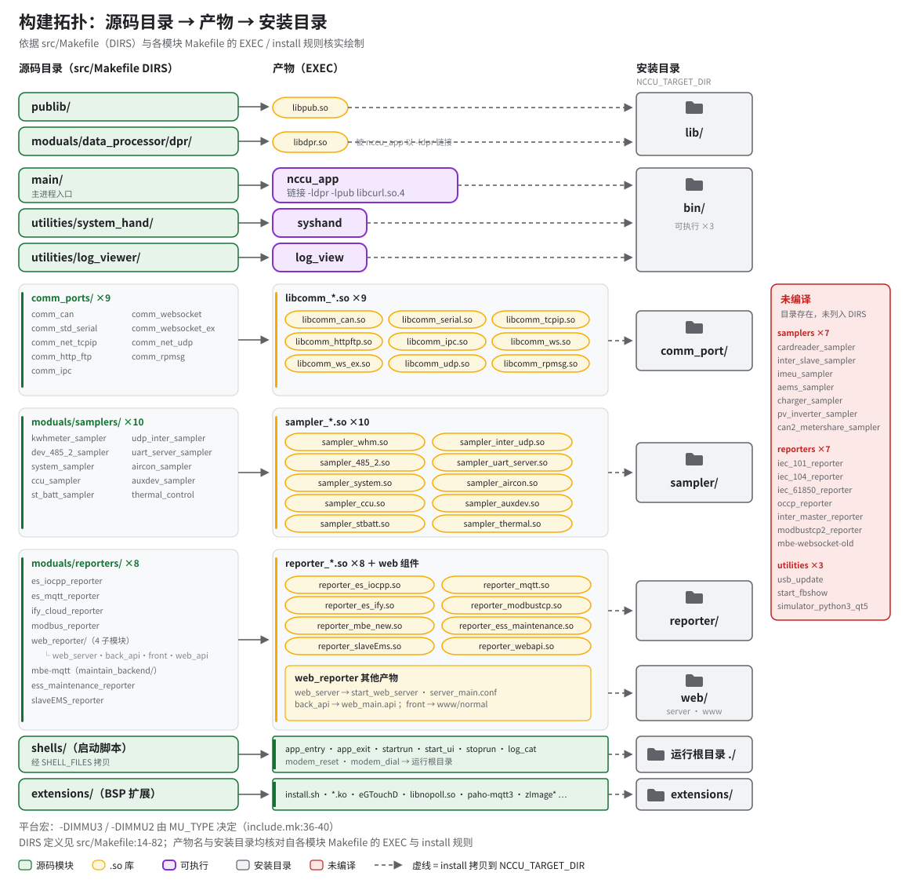
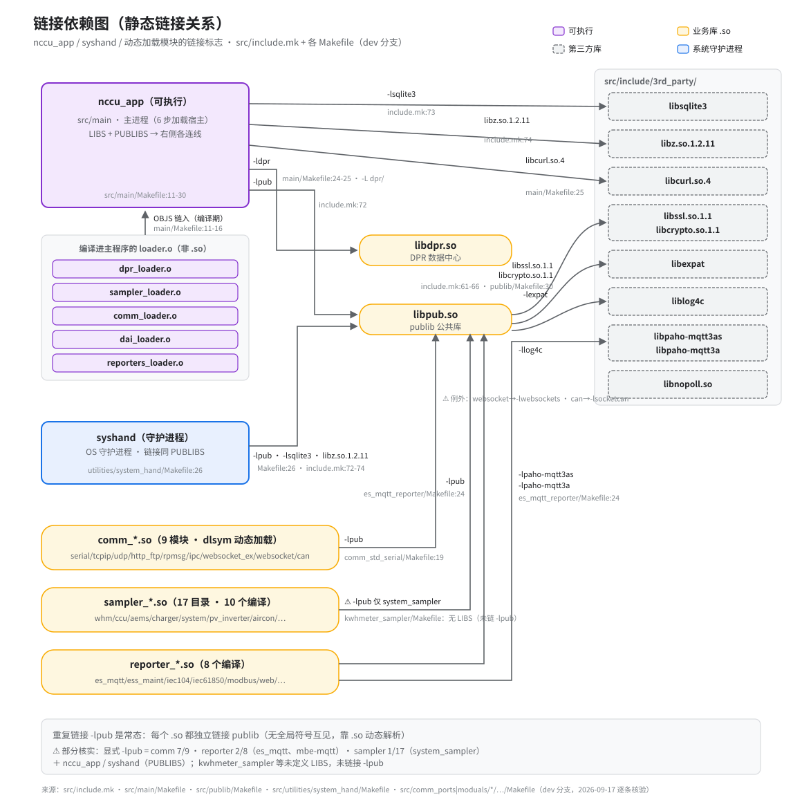
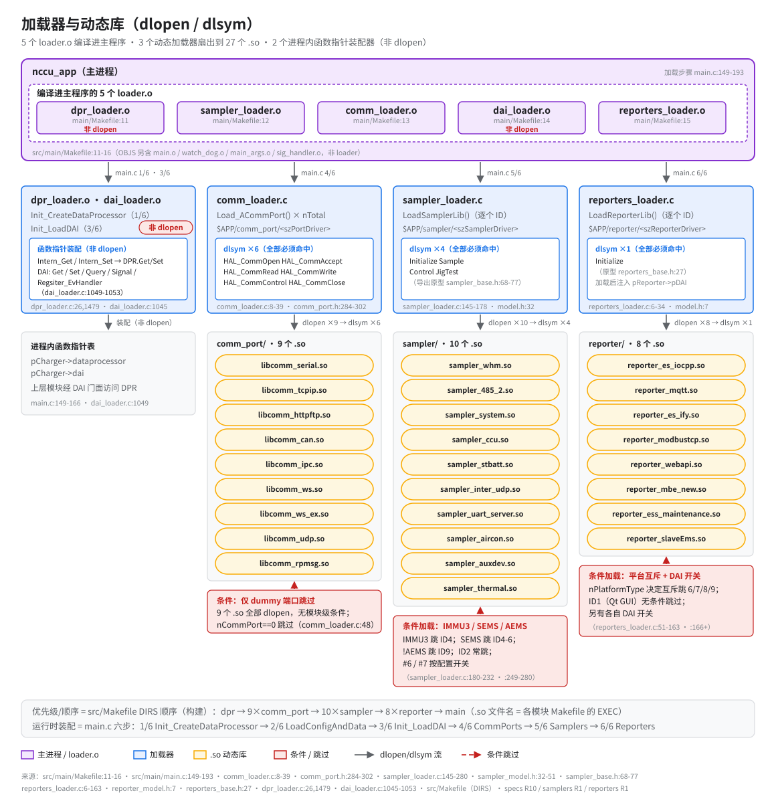
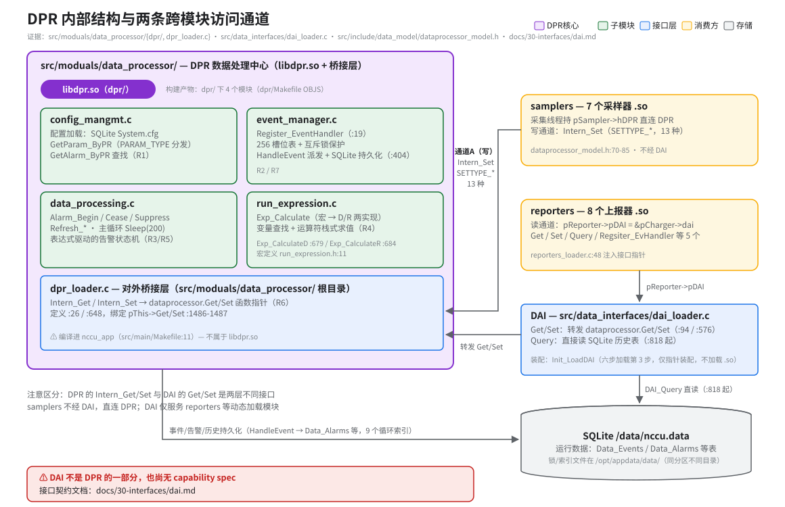

# 模块拓扑（Module Topology）

> **性质**：叙述性文档（读图指引 + 扩展说明）
> **需求权威源**：[`openspec/specs/comm-ports/spec.md`](../../openspec/specs/comm-ports/spec.md)、[`openspec/specs/samplers/spec.md`](../../openspec/specs/samplers/spec.md)、[`openspec/specs/reporters/spec.md`](../../openspec/specs/reporters/spec.md)、[`openspec/specs/data-processor/spec.md`](../../openspec/specs/data-processor/spec.md)
> **代码事实基线**：[`openspec/.code-facts-snapshot.md`](../../openspec/.code-facts-snapshot.md)
> **对应提交**：`e24d2863`
> **状态**：🟠 部分

## 读图顺序

四张图从静态到动态：先看哪些东西被编译出来，再看链接成什么形状，然后是运行期怎么被装进进程，最后深入 DPR 内部。

| 图 | 回答什么问题 | 何时看 |
|---|---|---|
| [图 1 · 构建拓扑](svg/topo-01-build-topology.svg) | 源码目录、构建产物、安装目录怎么对应？哪些模块实际参与编译？ | 加新模块、怀疑"有代码没功能" |
| [图 2 · 链接依赖](svg/topo-02-module-links.svg) | nccu_app / syshand / 各 `.so` 各自链接什么？谁依赖谁？ | 链接报错、引第三方库、排查符号缺失 |
| [图 3 · 加载器与动态库](svg/topo-03-loader-dlsym.svg) | 业务 `.so` 怎么被装进 nccu_app？各自的导出契约是什么？ | 改 dlsym 契约、模块加载失败、条件加载排查 |
| [图 4 · DPR 内部与两条通道](svg/topo-04-dpr-internals.svg) | 采样数据怎么进 DPR？上报器怎么读出来？ | 数据链路断点定位、DAI 与 DPR 接口混淆 |

---

## 图 1 · 构建拓扑

- `src/Makefile` 的 `DIRS`（`src/Makefile:14-71`）是唯一编译清单：进 DIRS 才编译，其余目录只是源码存在。产物分三类：可执行（`nccu_app` / `syshand` / `log_view`）、两个核心库（`libpub.so` / `libdpr.so`）、27 个业务 `.so`（9 comm + 10 sampler + 8 reporter）。
- 安装目录按类别分流：可执行进 `bin/`，核心库进 `lib/`，业务 `.so` 分别进 `comm_port/`、`sampler/`、`reporter/`，运行期由各 loader 从这些目录 dlopen。
- `extensions/` 也在 DIRS 里，装的是第三方运行件（noPoll、paho-mqtt 等），不是业务模块，图上按依赖库处理。
- 未编译模块（如 `cardreader_sampler`、`inter_slave_sampler`、多个 `iec_*` reporter）目录仍在源码树，但不在 DIRS，图 1 刻意不画它们，防止"有代码就有功能"的误判。

## 图 2 · 链接依赖

- 每个业务 `.so` 独立链接 `libpub.so`，没有全局符号互见；一个模块想用 publib 的能力，链接命令里要显式 `-lpub`。
- `nccu_app` 的链接面最宽：`-ldpr` + `libpub.so` + sqlite3 / z / libcurl 等系统与三方库（`src/main/Makefile`）。
- 5 个 loader 目标文件（`dpr_loader.o`、`sampler_loader.o`、`comm_loader.o`、`dai_loader.o`、`reporters_loader.o`，`src/main/Makefile:11-15`）直接编进主程序，不走 dlopen。换句话说，加载器本身的变更要换整个 app 镜像才能生效。
- `syshand` 与 nccu_app 共用同一组 PUBLIBS；`libpub.so` 自身经全局 LDFLAGS 链 libssl / libcrypto / expat / log4c（`include.mk`）。
- 例外只有两处：`comm_websocket` 链 **libwebsockets**（无 `-lpub`），`comm_can` 链 socketcan；图 2 上这两个节点不带 publib 依赖边，属正常形态。`comm_websocket_ex` 链 **noPoll**（`libnopoll.so` + `-lpub`），是带 publib 依赖边的正常节点。

## 图 3 · 加载器与动态库

- 三类动态模块的导出契约不同，这是"改协议先改 dlsym 契约"的根因：comm 6 函数（`comm_port.h:284-291`，dlsym 符号名表在同文件 `:297` 起）；sampler 4 函数（Initialize / Sample / Control / JigTest）；reporter 只有 1 个 `Initialize`（`reporter_model.h:7`）。
- 条件加载规则：samplers 对 IMMU3 / SEMS / AEMS 平台跳过特定 ID；reporters 由 `nPlatformType` 互斥跳过 6/7/8/9。同一个 `.so` 在某些平台上"存在但永远不加载"是预期行为。
- `dpr_loader` 与 `dai_loader` 名字里也有 loader，但做的是函数指针装配（把 DPR / DAI 入口挂进主程序），不经过 dlopen/dlsym。
- 图 3 与图 2 互补：图 2 管编译期谁链谁，图 3 管运行期谁被装进来，两图节点同名但语义不同。

## 图 4 · DPR 内部与两条通道

- 写通道与读通道分工明确：samplers 持 `hDPR` 句柄直接调 `Intern_Set` 写入（SETTYPE_* 共 13 种）；reporters 经 DAI 转发 `dataprocessor.Get/Set` 读出，`DAI_Query` 则直接读 SQLite。
- `DPR 的 Intern_Get/Intern_Set` 与 `DAI 的 Get/Set` 是两层不同接口，名字相近但层次不同：前者是 DPR 内部写入口，后者是 DAI 桥接层的对外读写门面。排查数据问题时先分清调用发生在哪一层。
- DPR 持久化到 `/data/nccu.data`，锁与索引文件在 `/opt/appdata/data/`；两条通道最终落在同一个 SQLite 世界里。
- DAI 不是 DPR 的一部分，也没有独立的 capability spec；契约描述以 [`../30-interfaces/dai.md`](../30-interfaces/dai.md) 为准。

## 已知限制 / 易踩点

- 未编译模块目录列表会误导：src 下有 `iec_104_reporter` 不等于产物里有它，判断以 DIRS 为准。
- 条件加载使"模块存在 ≠ 被加载"：同一个 `.so` 在不同平台 / 配置下可能整段跳过，行为差异查 sampler / reporter 的跳过逻辑，而不是查链接。
- reporter 只有 `Initialize` 一个导出点，dlsym 成功只证明符号存在，运行期行为完全由 Initialize 内部决定，排障可观测面窄。
- DAI 目前没有对应 spec，契约只在 `30-interfaces/dai.md`，属于权威源缺口，引用时注意版本核对。
- 构建产物数量是快照基线值（27 个业务 `.so`），增删模块后此数会漂移；引用前对照 DIRS 重数一遍，或查 `.code-facts-snapshot.md` 的漂移清单。

## 维护

- 图源在 [`svg/`](svg/)，写法遵循 [`../_meta/svg-style.md`](../_meta/svg-style.md)。
- 改 `src/Makefile` 的 `DIRS`、任一模块的 dlsym 契约、或 loader 的 `.o` 列表时，同步更新对应图的节点与 `file:line` 标注，并刷新本文头部的「对应提交」。
