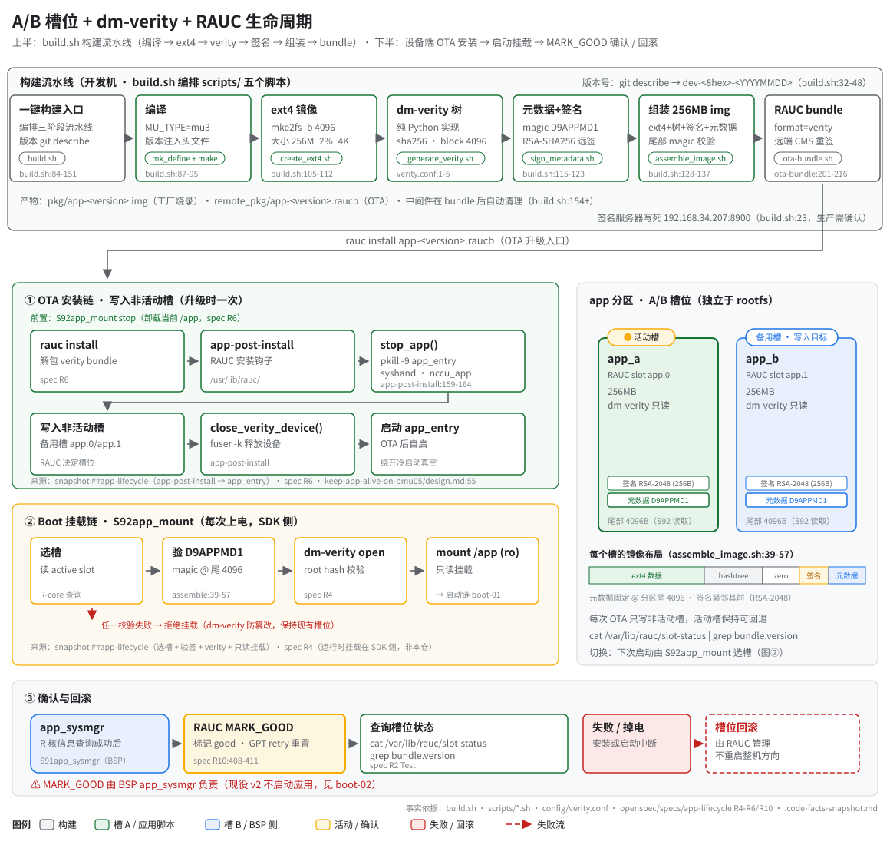

# A/B 槽位 + dm-verity + RAUC 生命周期（构建 → 部署 → 确认）

> **性质**：叙述性文档（读图指引 + 扩展说明）
> **需求权威源**：[`openspec/specs/app-lifecycle/spec.md`](../../openspec/specs/app-lifecycle/spec.md)（R6 RAUC OTA Bundle / R7 运行时启动链 / R10 app_sysmgr 契约）
> **代码事实基线**：[`openspec/.code-facts-snapshot.md`](../../openspec/.code-facts-snapshot.md)（`## app-lifecycle` 一节）
> **对应提交**：`e24d2863`
> **状态**：🟠 部分

## 读图顺序

图分上下两半：上半是开发机侧的构建流水线（`build.sh` 编排 `scripts/` 五个脚本），下半是设备侧的
A/B 生命周期，按时间顺序读三段：① OTA 安装（写非活动槽）→ ② 每次上电的挂载链（`S92app_mount`）
→ ③ 确认与回滚（`MARK_GOOD` / 槽位回滚）。右侧面板是两个槽位与镜像尾部布局的静态参考。

## 构建 → 部署链

- `build.sh` 三个 action（all/build/clean）编排三阶段：`do_compile` → `do_package` → `do_rauc_bundle`
  （`build.sh:84-151`）。版本号由 `git describe` 自动生成，注入 `src/version_patch.h`、镜像元数据与
  bundle 文件名（`build.sh:32-48`）。
- 打包顺序：`create_ext4.sh`（mke2fs -b 4096，大小 256M−2%−4K）→ `generate_verity.sh` → block size
  校验（`dumpe2fs` 必须 4096，`build.sh:110-112`）→ `sign_metadata.sh` → `assemble_image.sh` → 尾部
  magic 校验（`build.sh:128-137`）→ `ota-bundle.sh`。
- 镜像尾部布局（每个槽相同，`assemble_image.sh:39-57`）：`[ext4][hashtree][zero][签名][元数据]`，
  元数据固定在分区尾 4096，RSA-2048 签名紧邻其前；总大小严格等于 256MB。

## 为什么 verity 用纯 Python 生成

- `scripts/generate_verity.sh` 明确不依赖 `veritysetup` CLI（脚本第 2 行），而是内嵌 Python 逐 block
  计算 sha256 Merkle 树，参数来自 `config/verity.conf`（sha256 / data 4096 / hash 4096 / salt 32）。
- 动因：目标根文件系统（BusyBox 环境的 SDK 侧镜像）没有 `veritysetup`，构建机也不假设安装它；纯
  Python 让本仓自包含（spec R11 的独立构建要求）。设备端的 verity **挂载**（dm-verity open）仍由
  SDK 侧 `S92app_mount` 完成，本仓只负责构建期生成 hashtree 与元数据（spec R4 范围说明）。

## D9APPMD1 magic

- 元数据二进制以 ASCII `D9APPMD1` 开头（`sign_metadata.sh`，格式见 spec R5），固定写在 app.img 的
  分区尾 4096 处；构建结束用 `dd skip=partition-4096 count=8` 读取校验（`build.sh:135-137`）。
- 设备端每次上电，`S92app_mount` 选槽后先验这个 magic，再做 dm-verity open 与只读挂载 `/app`
  （快照 `## app-lifecycle` 的 boot 路径块）——它是「这个槽是合法 app 镜像」的第一道判据。

## RAUC MARK_GOOD 的归属

- `MARK_GOOD` 不是本仓代码：它由 BSP 侧 `/usr/sbin/app_sysmgr` 在 R 核信息查询成功后执行，日志串
  `MARK_GOOD ok (slot %c GPT retry reset)`，失败仅 WARN 不致命（spec R10 RAUC 槽位标记 Scenario）。
- 注意：app_sysmgr 现役 v2 **不启动应用**（对 app_entry 的 strings 匹配数为 0，spec R10 v1→v2 追溯），
  boot 路径是**启动责任真空**（`S92app_mount` 只挂载、其 `run_app()` 是死代码不得加回；BSP `add-system-mgmt-service` R2 未交付），
  **唯一会自动启动应用的路径是 OTA 的 `app-post-install`**，归因见 [boot-chain.md 图 2](boot-chain.md)。
- ⚠️ app-lifecycle spec R10 的措辞仍写着启动 owner 是 `S92app_mount`（boot 路径）——与代码不符（spec-code drift，见 tech-debts.md）。
- 设备端查询槽位版本：`cat /var/lib/rauc/slot-status | grep bundle.version`（spec R2 Test）。

## 回滚立场

- 安装只写**非活动槽**（`rauc install` 解包到 app.0/app.1 中的备用槽，spec R6），活动槽保持可回退；
  安装前需先 `S92app_mount stop` 卸载 `/app`。
- 安装链内部先停旧实例：`stop_app()` 执行 `pkill -9 app_entry syshand nccu_app`
  （`app-post-install:159-164`），再由 `close_verity_device()` 的 `fuser -k` 兜底释放 dm 设备，最后
  直接启动 `app_entry` —— 这是当前唯一能绕开「冷重启无人启动」真空的路径。
- 失败或掉电时，槽位回滚由 RAUC 管理（boot 重试计数 + good/bad 标记）；既定方向是**不重启整机**，
  应用级自愈/监管设计见 [`keep-app-alive-on-bmu05/design.md`](../../openspec/changes/keep-app-alive-on-bmu05/design.md)。

## 维护

图源文件在 [`svg/`](svg/)，风格遵循 [`docs/_meta/svg-style.md`](../_meta/svg-style.md)；改动
`build.sh`、`scripts/*.sh` 或 `config/verity.conf` 时复核图中 `file:line`，并同步更新头部「对应提交」。
