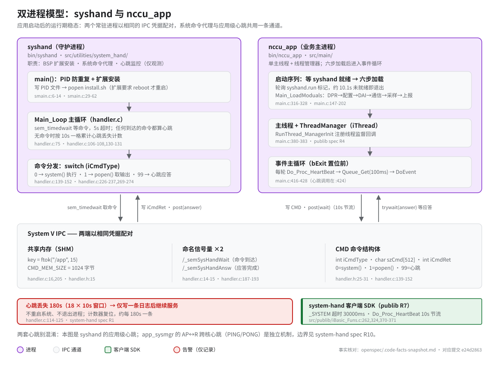

# 双进程模型（syshand × nccu_app）

> **性质**：叙述性文档（读图指引 + 扩展说明）
> **需求权威源**：[`openspec/specs/system-hand/spec.md`](../../openspec/specs/system-hand/spec.md)（R1 心跳监控 / R2 BSP 扩展安装 / R3 系统命令代理 / R5 PID 文件管理）+ [`openspec/specs/publib/spec.md`](../../openspec/specs/publib/spec.md)（R7 system-hand 客户端 SDK）
> **代码事实基线**：[`openspec/.code-facts-snapshot.md`](../../openspec/.code-facts-snapshot.md)（`## system-hand`、`## publib` 两节）
> **对应提交**：`e24d2863`
> **状态**：🟠 部分

## 图

图覆盖应用启动完成后的运行期稳态。启动侧（谁拉起这两个进程、`syshand.run` 之前发生了什么）
不在本图范围，见[应用启动链](boot-chain.md)。

## 扩展说明

### 为什么拆成两个进程

命令代理放在独立守护进程里形成隔离域：执行外部 shell 命令的失败面（阻塞、僵尸子进程、
环境差异）不直接落在业务主进程内，`_SYSTEM` 调用方只面对带错误码的同步应答
（`iBasic_Funs.c:371` 起，publib R7）。反过来，业务进程异常退出也不牵连 syshand，
它仍能继续代理命令——"谁缺位之后由谁补救"则归启动与监管层（app-boot / 未来
app-supervision），不是本图两进程互相兜底。

### syshand 为什么定位成 OS HAL

syshand 对上只暴露三类能力：BSP 扩展安装（R2）、系统命令代理（R3）、就绪标记发布（R4）。
它曾承担的"心跳丢失即修复系统"职责已从本分支代码中移除（`reboot` 调用不存在，非注释），
心跳退化为纯可观测性手段。给 OS 执行代理、交出系统裁判权——这就是它与未来应用监管层
的分工边界：syshand 保留，但不再决定整机命运。

### 180s 心跳语义：记录即终局

阈值到达（18 × 10s 窗口）只产生一条 ERROR 日志并复位计数器（`handler.c:114-125`），
该行为已确认为设计而非调试试态，验收语义归 system-hand R1。因此运行日志里周期性出现
heartbeat lost 不代表故障升级路径被触发——没有升级路径。进程级的拉活与回滚由未来的
app-supervision 承担；在此实现落地前，心跳日志是判断 nccu_app 存活的主要线索之一。

### IPC 超时的不对称设计

命令路径是同步阻塞的：调用方进程内互斥锁等待上限 30000ms（`_SYSTEM_LOCK_WAIT_TIMEOUT`，
`iBasic_Funs.c:370`），持锁期间同进程后续 `_SYSTEM` 调用排队。心跳路径刻意避开这个代价：
10s 节流 + 100ms 互斥锁快速失败 + `sem_trywait` 轮询应答（`iBasic_Funs.c:279,284,332-354`），
保证 nccu_app 事件主循环每轮不被 IPC 卡死。读代码或日志时两条路径的超时常量不可互换。

### 配对凭据是隐式契约

两端各自以 `ftok("/app",15)` 与同名信号量路径配对（`handler.c:14-16` 服务端、
`iBasic_Funs.c:44` 一带客户端），编译期没有任何一致性检查。任何一端单独改动 key 或
信号量路径，症状是命令静默无应答、心跳不再计数，而不是显式报错——排查跨进程通信
失效时，第一步是比对两侧常量是否仍然成对。

## 相邻文档

| 主题 | 去处 |
|---|---|
| 这两个进程如何被拉起、冷重启断点 | [应用启动链](boot-chain.md) |
| 心跳/命令/IPC/PID 的验收语义 | system-hand spec R1-R5 |
| 客户端 SDK（`_SYSTEM`/心跳）验收语义 | publib spec R7 |
| Agent 速查（IPC key、超时、阈值） | [AGENTS.md](../../AGENTS.md) |
