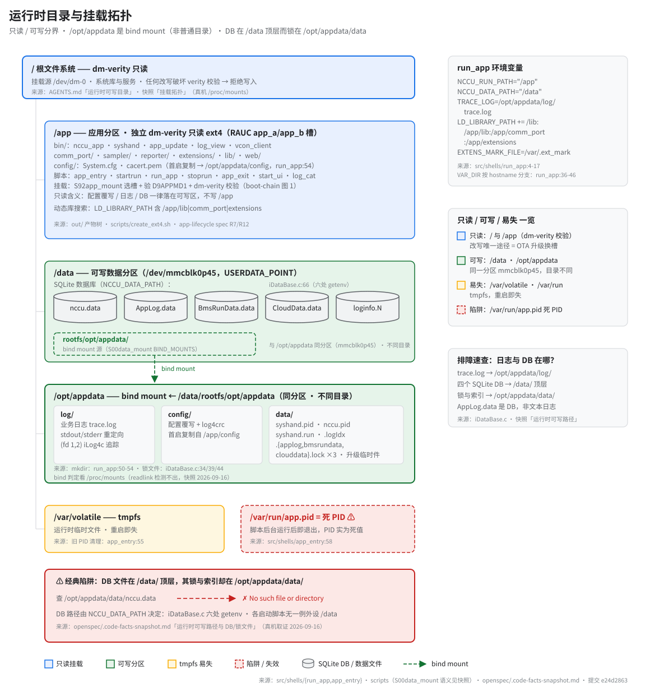

# 运行时目录与挂载拓扑

> **性质**：叙述性文档（读图指引 + 扩展说明）
> **需求权威源**：[`openspec/specs/app-lifecycle/spec.md`](../../openspec/specs/app-lifecycle/spec.md)（R7 运行时启动链 / R12 mu3 平台启动脚本与主脚本功能一致）
> **代码事实基线**：[`openspec/.code-facts-snapshot.md`](../../openspec/.code-facts-snapshot.md)（「运行时可写路径与 DB/锁文件」节）
> **对应提交**：`e24d2863`
> **状态**：🟠 部分

## 读图

一张图回答三个问题：哪些路径只读、哪些可写、DB 与日志到底落在哪。与[启动链](boot-chain.md)互补：那组图讲"谁在什么时候执行"，本图讲"进程跑起来后脚下的地面长什么样"。

图例颜色三态：蓝＝只读挂载、绿＝可写、琥珀＝tmpfs；红色虚线专标陷阱与失效路径（版式约定见 [`docs/_meta/svg-style.md`](../_meta/svg-style.md)）。

## 目录清单速览

| 挂载点 | 属性 | 内容 | 依据 |
|---|---|---|---|
| `/` | dm-verity 只读 | 系统库、`/usr/sbin/app_sysmgr`、init 脚本 | AGENTS.md「运行时可写目录」 |
| `/app` | dm-verity 只读（独立 ext4） | `bin/`、`comm_port/`、`sampler/`、`reporter/`、`extensions/`、`lib/`、`web/`、`config/`、启动脚本 | `out/` 产物树 · app-lifecycle R7/R12 |
| `/data` | 可写 | 四个 SQLite 库 + `loginfo.N` + `rootfs/opt/appdata/`（bind 源） | `S00data_mount` · `iDataBase.c:66` |
| `/opt/appdata` | 可写（bind mount） | `log/`、`config/`、`data/`（PID/锁/索引/升级临时件） | `run_app:49-54` · 快照取证 |
| `/var/volatile`、`/var/run` | tmpfs 易失 | 临时文件、死 PID 文件 | `app_entry:55,58` |

## 环境变量与路径决策

- 路径全部由 `run_app` 注入环境变量后才生效（`run_app:4-17`）：`NCCU_RUN_PATH=/app` 决定运行目录与 `cd`，`NCCU_DATA_PATH=/data` 决定四个 DB 的落点，`LD_LIBRARY_PATH` 追加 `/app/lib`、`/app/comm_port`、`/app/extensions` 供 `dlsym` 动态加载 HAL 模块。
- `TRACE_LOG` 指向 `/opt/appdata/log/trace.log`，是排障时第一个要看的文件。
- `VAR_DIR` 按 hostname 分支（`run_app:36-46`）：`bmu*` 主机名取 `/opt/appdata/data`，否则取当前目录 `.`——同一份代码在不同设备上的可写行为不同，读代码时别假设唯一值。
- 改这些路径等于改 DB/日志落点；历史上所有平台变体（`startrun` / `mu3/startrun` / `run_app` / `start_ui` 等）无一例外把 `NCCU_DATA_PATH` 设成 `/data`，快照列为 DB 路径的 4 条证据之一。

## 只读 / 可写分界

- **只读两侧**：`/`（rootfs，`/dev/dm-0`）与 `/app`（应用分区，RAUC `app_a`/`app_b` 槽）都受 dm-verity 保护，任何就地改写都会校验失败。改写它们的唯一正道是 OTA 换槽（app-lifecycle spec R4/R6），不要尝试 remount。
- **可写侧只有两处**：`/data`（`/dev/mmcblk0p45`）与 `/opt/appdata`。其余一概易失：`/var/volatile`、`/var/run` 是 tmpfs，重启即清空。
- `/app` 内的 `config/`（`System.cfg`、`cacert.pem`）只是出厂副本；首次启动由 `run_app:54` 复制到 `/opt/appdata/config/`，运行期配置以那份覆写为准。

## bind mount：DB/锁分裂为何容易踩坑

- `/opt/appdata` **不是 `/data` 下的普通目录**，而是 bind mount，源为 `/data/rootfs/opt/appdata`（`S00data_mount` 的 `BIND_MOUNTS`）。二者同分区、不同目录。
- 于是 DB 与它的锁文件天然分家：四个 SQLite 库（`nccu.data` / `AppLog.data` / `BmsRunData.data` / `CloudData.data`）在 **`/data` 顶层**（`iDataBase.c` 六处 `getenv("NCCU_DATA_PATH")`），而锁与索引（`.applog.lock` 等、`.logIdx`）在 **`/opt/appdata/data/`**（`iDataBase.c:34/39/44`）。
- 后果：`/opt/appdata/data/nccu.data` **不存在**，按这个路径找库必然扑空。4 条独立取证见快照「运行时可写路径与 DB/锁文件」。
- 判定方法教训：`readlink -f` 检测不出 bind mount；要看 `/proc/mounts` / `findmnt` / `mountpoint -q`（快照 2026-09-16 记录过一次误判）。

## 日志重定向

- 应用 stdout/stderr（fd 1、2）与 `iLog4c` 追踪都汇入 `/opt/appdata/log/trace.log`（`run_app:5,47`）。
- 目录由 `run_app:50` 幂等 `mkdir -p`，所以即使 `/opt/appdata` 被清空，应用也能自己长出骨架。
- 注意 `AppLog.data` 是 SQLite 数据库文件，不是文本日志——对它 `grep -c` 得到的是二进制页里的偶然匹配，不能当事件计数（快照同节）。

## kiosk / verity 影响

- 设备无交互 shell 习惯，排障入口就是本图右栏那张速查卡：日志看 `/opt/appdata/log/`，业务数据看 `/data/`，PID 与锁看 `/opt/appdata/data/`。
- 只读 rootfs 意味着"改个配置重启试试"这条路不存在：`/etc`、`/usr` 的任何调整都会在下次校验/升级时丢失，能持久的只有 `/data` 一侧。
- `/var/run/app.pid` 是死 PID（`app_entry:58` 写入后脚本即退出），依赖它做进程管理的工具读到的是空值——这正是 [`boot-chain.md`](boot-chain.md) 图 2 讨论的启动真空在文件系统的投影。
- 升级临时件（`upgradefile`、`pkg.sum`、`firm_tmp_extract/` 等）落在 `/opt/appdata/data/`，与 DB、锁同目录但互不相干；清理时可写区时注意别误删 `.lock` 与 `.logIdx`。

## 在设备上核对

把本图的断言落到真机时，几条只读命令足够：

- `grep -E ' /data | /opt/appdata ' /proc/mounts`——同时看到 `/dev/mmcblk0p45` 两次即为 bind mount 实锤；
- `ls /data/*.data` 与 `ls /opt/appdata/data/`——前者应有四个 `.data` 库，后者只有锁、PID 与索引；
- `stat /opt/appdata/data/nccu.data`——预期 `No such file or directory`，这是快照证据链的第 4 条；
- `tail /opt/appdata/log/trace.log`——应用启动与崩溃的第一现场。

## 相关文档

- 启动链与启动真空：[`boot-chain.md`](boot-chain.md)（图 1 全链路 / 图 2 归因）
- 事实基线与取证过程：[`openspec/.code-facts-snapshot.md`](../../openspec/.code-facts-snapshot.md)
- 需求语义（挂载、启动链、升级）：[`openspec/specs/app-lifecycle/spec.md`](../../openspec/specs/app-lifecycle/spec.md)
