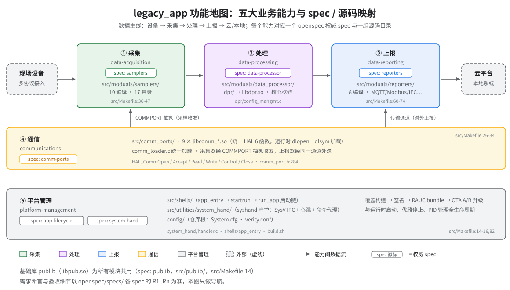

# 功能与规格摘要

> **性质**：叙述性文档（读图指引 + 功能摘要）
> **需求权威源**：[`openspec/specs/`](../../openspec/specs/) 共 7 个：[comm-ports](../../openspec/specs/comm-ports/spec.md) / [publib](../../openspec/specs/publib/spec.md) / [system-hand](../../openspec/specs/system-hand/spec.md) / [app-lifecycle](../../openspec/specs/app-lifecycle/spec.md) / [data-processor](../../openspec/specs/data-processor/spec.md) / [samplers](../../openspec/specs/samplers/spec.md) / [reporters](../../openspec/specs/reporters/spec.md)
> **代码事实基线**：[`openspec/.code-facts-snapshot.md`](../../openspec/.code-facts-snapshot.md)
> **对应提交**：`86f803b5`
> **状态**：✅ 已建立（5 页）

## 功能地图

- 系统按数据主线组织为五个业务能力：**采集 → 处理 → 上报** 构成水平主线，**通信** 作为侧翼能力带同时支撑采集与上报，**平台管理** 作为底部能力带覆盖构建、部署与运行时生命周期。
- 采集、处理、上报之间只以数据衔接：samplers 采样后交给 DPR，DPR 产出事件、告警与历史记录，再由 reporters 对外报送；三者均为 `.so` 动态模块，由各自的 loader 在运行时加载（`sampler_loader.c` / `reporters_loader.c` / `comm_loader.c`）。
- 通信是传输无关的抽象层：9 个协议模块导出统一的 HAL 6 函数，采集器经 `COMMPORT` 抽象收发设备数据，上报器经同一通道对接云端与本地系统。
- 平台管理跨两个 spec：app-lifecycle 覆盖「构建 → 签名 → RAUC bundle → OTA A/B」与「启动链 → 初始化 → 优雅停止」；system-hand 覆盖 syshand 守护进程（SysV IPC、心跳监控、系统命令代理）。
- 基础库 publib（`libpub.so`）不对应独立业务能力，但为上述所有模块提供线程、锁、队列、内存池、日志与 SQLite 封装。

## 功能速览

### 采集（data-acquisition）

`sampler_loader.c` 按 `src/Makefile:36-47` 的清单加载 10 个采样器 `.so`；每个采样器导出统一的 4 个入口函数（Init / Sample / Control / JigTest，接口规范见 samplers spec R3）。采样器不直接触碰传输细节，而是经通信层的 `COMMPORT` 抽象收发设备报文，采样结果交 DPR 处理。`src/moduals/samplers/` 下共 17 个子目录，其中 7 个未列入编译清单，属预留或平台相关变体。

### 处理（data-processing）

DPR（`libdpr.so`）是系统核心枢纽，架构位置为 samplers → **DPR** → reporters。配置经 SQLite 数据库 `/app/config/System.cfg` 加载（实现于 `config_mangmt.c`，非 INI 文件）；运行期完成表达式运算、规则判断、事件与告警生成，并落历史数据（运行时 `$NCCU_DATA_PATH/nccu.data`，即 `/data/nccu.data`）。跨模块数据访问经 DAI，见 data-processor spec R6。

### 上报（data-reporting）

`reporters_loader.c` 加载 8 个上报器（`src/Makefile:60-74`），通道覆盖 MQTT、英飞源云、Modbus、Web 服务、IEC 101/104/61850、OCPP、运维后台与从站 EMS（各通道语义见 reporters spec R2–R12）。上报器之间存在平台互斥：由 `nPlatformType` 决定部分通道在特定机型上跳过。

### 通信（communications）

9 个协议模块（串口 / TCP / UDP / CAN / IPC / WebSocket×2 / HTTP-FTP / RPMSG）各自编译为 `libcomm_*.so`，导出统一的 HAL 6 函数（`HAL_CommOpen` / `Accept` / `Read` / `Write` / `Control` / `Close`，原型自 `comm_port.h:284` 起）；`comm_loader.c` 在运行时 `dlopen` + `dlsym` 按需加载。上层业务只面向函数指针，不感知底层传输。

### 平台管理（platform-management）

app-lifecycle 侧：`build.sh` 一键编排「编译 → ext4+dm-verity 镜像 → 签名 → RAUC bundle」，版本号自 `git describe` 生成并注入产物；设备侧经 `S92app_mount` 挂载 `/app` 后由 `app_entry → startrun → run_app` 链拉起 `syshand` 与 `nccu_app`（注意：冷重启路径当前无人触发该链，见 boot-chain.md；唯一自动启动路径是 OTA 的 app-post-install）。system-hand 侧：syshand 以 System V 共享内存 + 双信号量与主进程配对，代执行系统命令并监控心跳（心跳丢失约 180s 后仅记录告警、继续服务，见 system-hand spec R1）。

## 功能 ↔ spec ↔ 源码 映射表

| 功能 | spec | 主要 R | 源码目录 | 运行产物 |
|---|---|---|---|---|
| 采集 data-acquisition | [samplers](../../openspec/specs/samplers/spec.md) | R1–R3（加载/调度/接口）、R5–R14（各采样器） | `src/moduals/samplers/`（10 编译 / 17 目录，`src/Makefile:36-47`） | `sampler_*.so` × 10 |
| 处理 data-processing | [data-processor](../../openspec/specs/data-processor/spec.md) | R1–R7（配置/事件/告警/表达式/主循环/DAI/DB） | `src/moduals/data_processor/dpr/` | `libdpr.so` |
| 上报 data-reporting | [reporters](../../openspec/specs/reporters/spec.md) | R1（加载）、R2–R12（各协议） | `src/moduals/reporters/`（8 编译，`src/Makefile:60-74`） | 各 reporter `.so` × 8 |
| 通信 communications | [comm-ports](../../openspec/specs/comm-ports/spec.md) | R1（HAL 抽象）、R2–R9（各协议）、R10（加载）、R11–R12（控制/错误） | `src/comm_ports/`（9 模块，`src/Makefile:26-34`） | `libcomm_*.so` × 9 |
| 平台管理 platform-management | [app-lifecycle](../../openspec/specs/app-lifecycle/spec.md) + [system-hand](../../openspec/specs/system-hand/spec.md) | app-lifecycle R1–R9（构建/镜像/运行时）；system-hand R1–R5 | `src/shells/` · `src/utilities/system_hand/` · `config/`（仓库根） | `app_entry`/`run_app` 脚本、`bin/syshand`、`.raucb` bundle |
| （共用基础库）publib | [publib](../../openspec/specs/publib/spec.md) | R1–R9（队列/日志/锁/线程/内存/DB/SDK） | `src/publib/`（`src/Makefile:14`） | `libpub.so` |

> 编译清单以 `src/Makefile` 的 `DIRS` 为准；模块数量、路径与行号的核对基线见 `.code-facts-snapshot.md`。

## 五个功能页

每篇按同一能力展开叙述，验收语义一律链接到对应 spec 的 `R<n>`，不在 docs 内复制：

- [data-acquisition.md](data-acquisition.md) — 采集：采样器加载、采样线程调度与各设备采样
- [data-processing.md](data-processing.md) — 处理：DPR 数据中心的配置、事件、告警与表达式
- [data-reporting.md](data-reporting.md) — 上报：云端/本地/运维通道的各协议上报器
- [communications.md](communications.md) — 通信：HAL 6 函数与 9 个协议模块
- [platform-management.md](platform-management.md) — 平台管理：构建部署、启动链与 syshand 守护

## 阅读建议

先读本页与上方功能地图建立全局印象，再按需进入单篇功能页；单页只回答「这个能力是什么、由哪些模块组成、边界在哪」，需要验收级细节（Scenario、依赖、错误码）时跳转对应 spec 的 `R<n>`。代码事实（模块数、行号、路径）与本文不一致时，以代码与 `.code-facts-snapshot.md` 为准，并回填本页「对应提交」。

## 边界速记

- 采集只负责「从设备到 DPR」：传输细节归通信层，数据语义处理归 DPR（见 samplers spec R3/R4）。
- 处理不选择对外通道：DPR 产出的数据交给哪个上报器，由配置与 reporters 的加载机制决定（data-processor spec R1 / reporters spec R1）。
- 上报不含设备侧采集：上报器的输入是 DPR 的数据视图，不直接与现场设备通信（reporters spec R1）。
- 通信不理解业务语义：HAL 只搬运字节流，协议解析在采样器/上报器内完成（comm-ports spec R1）。
- 平台管理不含业务数据处理：构建、部署、启动链与守护均为生命周期支撑（app-lifecycle spec Purpose）。

## 维护

- 触发同步的工程变更：`src/Makefile` 的 `DIRS` 增删、模块目录改名、spec 新增/修订 R（见 [`_meta/authority-contract.md`](../_meta/authority-contract.md) 的更新触发表）。
- 功能地图 SVG 为手写文件，修改后请保持根元素模板、每 `<text>` 的 font-family 与语义配色不变（规范见 [`docs/_meta/svg-style.md`](../_meta/svg-style.md)）。
- 五篇功能页已建立；修改时沿用本页头部模板与「只链接、不复制断言」的约定。
