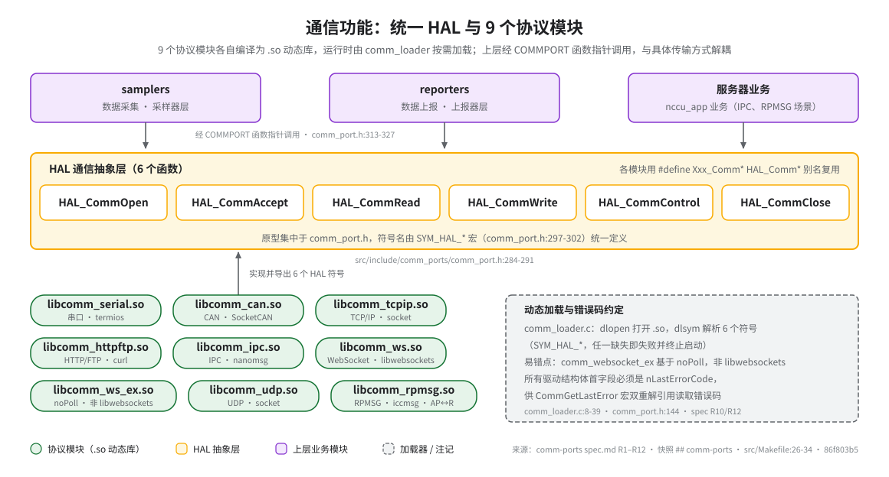

# 通信功能：统一 HAL 与 9 个协议模块

> **性质**：叙述性文档（需求断言以 spec 为准）
> **需求权威源**：`openspec/specs/comm-ports/spec.md`（R1–R12）
> **代码事实基线**：`openspec/.code-facts-snapshot.md`
> **对应提交**：`86f803b5`
> **状态**：🟠 部分

## 读图指引

- 上层三框（samplers / reporters / 服务器业务）不直接触碰协议细节，而是经 `COMMPORT` 结构体中的函数指针调用（`src/include/comm_ports/comm_port.h:313-327`）。
- 中间黄色区域是 HAL 抽象层，只暴露 6 个函数；底部绿色胶囊是 9 个模块的编译产物名，逐一核对自各模块 `Makefile` 的 `EXEC` 变量。

## 传输无关抽象的价值

所有协议模块编译为独立 `.so` 动态库（`src/Makefile:26-34`，9 个 DIRS 全部编译），导出同一套 6 个 HAL 函数符号。`comm_loader.c` 在运行时按配置中的 `szPortDriver` 字段 `dlopen` 对应库文件（`src/comm_ports/comm_loader.c:32-36`），上层代码只面向 `COMMPORT` 函数指针编程。更换传输方式（如 TCP 换 WebSocket）对采样、上报代码透明，只需改配置中的驱动库名与端口参数。

## 6 个函数的语义

原型集中定义于 `src/include/comm_ports/comm_port.h:284-291`：

| 函数 | 语义 |
|------|------|
| `HAL_CommOpen` | 按端口描述符/打开参数打开端口，返回句柄 |
| `HAL_CommAccept` | TCP/WS Server 接受客户端连接，返回新句柄 |
| `HAL_CommRead` | 读取数据（超时行为由 `COMM_TIMEOUTS` 控制，-1 为永久等待） |
| `HAL_CommWrite` | 写出数据 |
| `HAL_CommControl` | 运行时控制命令入口（波特率、过滤器、TLS 证书、客户端上限等，见 R11） |
| `HAL_CommClose` | 关闭端口 |

符号名由 `SYM_HAL_*` 宏统一给定（`comm_port.h:297-302`）；各模块用 `#define Xxx_CommOpen HAL_CommOpen` 之类的别名宏，把自身实现映射到这 6 个名字后导出（如 `comm_socketcan.h:27-32`、`commsock.h:24-29`）。

## 9 个模块与产物名

产物名核对自各模块 `Makefile` 的 `EXEC`（注意三个名字容易想当然写错）：

| 能力 | 源码目录 | 产物 | 底层依赖 |
|------|----------|------|----------|
| 串口 | `comm_std_serial/` | `libcomm_serial.so` | termios |
| CAN | `comm_can/` | `libcomm_can.so` | Linux SocketCAN |
| TCP/IP | `comm_net_tcpip/` | `libcomm_tcpip.so` | Linux socket |
| HTTP/FTP | `comm_http_ftp/` | `libcomm_httpftp.so` | curl |
| IPC | `comm_ipc/` | `libcomm_ipc.so` | nanomsg |
| WebSocket | `comm_websocket/` | `libcomm_ws.so` | libwebsockets |
| WebSocket EX | `comm_websocket_ex/` | `libcomm_ws_ex.so` | noPoll |
| UDP | `comm_net_udp/` | `libcomm_udp.so` | Linux socket |
| RPMSG | `comm_rpmsg/` | `libcomm_rpmsg.so` | iccmsg (SSDK) + rpmsg/ipcc 驱动 |

## 一个易错点：WebSocket 有两个实现

`comm_websocket/` 基于 **libwebsockets**，`comm_websocket_ex/` 基于 **noPoll**——不是 libwebsockets 的增强版，而是一套并行实现（spec R5）。二者通过配置中的 `szPortDriver` 选择加载；`COMM_SET_WS_GLOBAL_TLS_ROOT_CAFILE` 等部分控制命令仅对 libwebsockets 实现生效（spec R5「TLS 证书配置」场景）。

## 错误码机制

所有驱动内部结构的**第一个字段必须是 `int nLastErrorCode`**（如 `UDP_PORT_DRV`、`CAN_PORT_DRV`、`STcpipPortDriver`）。`CommGetLastError(hPort)` 宏（`comm_port.h:144`）展开为 `(**(int**)(hPort))` 双重解引用，直接把句柄当结构体指针读首字段——字段顺序一旦变动，读到的就是垃圾值。错误码取值来自 `COMM_ERROR` 枚举（`comm_port.h:65-88`），控制命令通道也可用 `COMM_GET_LAST_ERROR` 查询同一错误码（spec R11/R12）。

## 加载时序与失败行为

主进程启动第 4/6 步调用 `Init_Load_AllCommPorts`，遍历配置中的全部端口（`src/comm_ports/comm_loader.c:41-64`）：`nCommPort == 0` 的虚拟端口直接跳过；真实端口逐一 `dlopen` + `dlsym` 解析 6 个符号（`TRUE` 参数要求全部找到）。任一库缺失或符号缺失都会记录 `"Can NOT load the comm port [%s]"` 并使启动流程终止（`comm_loader.c:54-59`）——所以新增模块后必须确认产物名与配置中的 `szPortDriver` 完全一致。

## 串口设备名的平台差异

串口设备名前缀由编译宏 `IMMU3` 决定（`comm_port.h:334-344`）：IMMU3 平台为 `ttyO`，D9360/BMU05/EMU01 等平台为 `ttyS`；`TTYS_USB2="/dev/ttyUSB2"` 在所有平台可用。RS485/RS232 模式经 `COMM_SET_SERIAL_485` 等控制命令切换（spec R9）。

## 相关文档

## 相关文档

- 需求全量：`openspec/specs/comm-ports/spec.md`（R1 抽象层 / R2 CAN / R3 TCP / R4 UDP / R5 WebSocket / R6 HTTP-FTP / R7 IPC / R8 RPMSG / R9 串口 / R10 加载 / R11 控制命令 / R12 错误处理）
- 事实基线：`openspec/.code-facts-snapshot.md` 的 `## comm-ports` 节
- HAL 函数签名速查：`30-interfaces/hal-comm.md`
