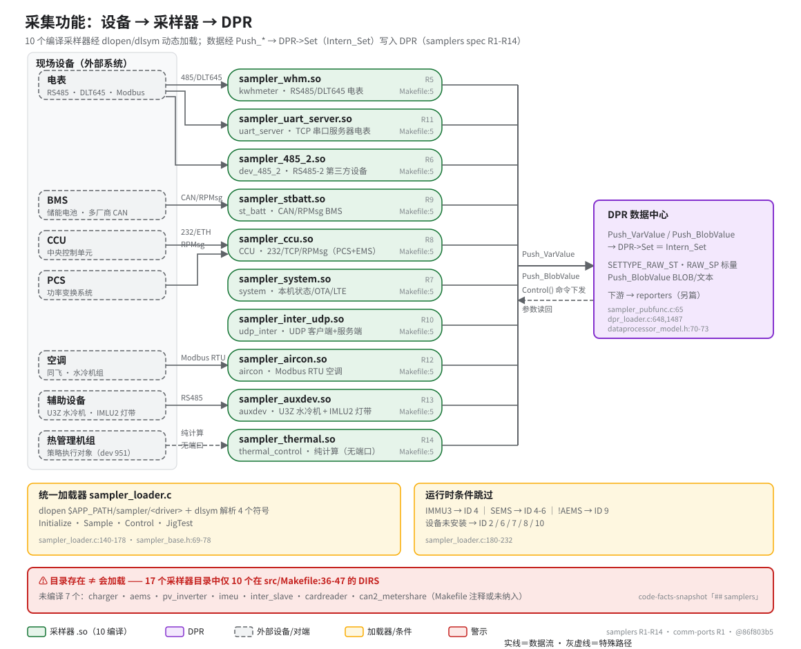

> **性质**：叙述性文档
> **需求权威源**：`openspec/specs/samplers/spec.md`（R1–R14）+ [`comm-ports`](../../openspec/specs/comm-ports/spec.md)（R1，6 个 HAL 函数）
> **代码事实基线**：`openspec/.code-facts-snapshot.md`
> **对应提交**：`86f803b5`
> **状态**：🟠 部分

# 采集：设备 → 采样器 → DPR

## 图

读图要点：左列为现场设备（外部系统）；中列 10 个胶囊是编译进固件的采样器 `.so`，名称取自各目录 `Makefile:5` 的 `EXEC` 真值；右侧 DPR 是采集数据的唯一落点。`sampler_system`（本机/OTA/LTE）与 `sampler_inter_udp`（UDP 对端）不接现场设备，故未画左侧连线；`sampler_thermal` 无物理端口，图中以灰虚线示意。

## 采集职责与边界

- 采样器只做**采集与归一**：收发协议帧、解析、均值滤波（`Samp_Avg_Filter`）、推送原始值；业务判断在 DPR（表达式/告警），对外上报在 reporters——三层解耦，架构链为「设备 → samplers → DPR → reporters」（samplers spec Purpose）。
- **传输无关**：采样器不直接触碰串口/TCP/CAN，一律通过 `COMMPORT*` 抽象收发（comm-ports spec R1；6 个 HAL 函数原型见 `comm_port.h:284-291`）。
- 通信异常经 `SetCommStatus()` 转为 `EVENT_TYPE_COMM_FAIL` 事件进入 DPR（samplers spec R4）。

## 4 个导出函数（每个 `.so` 的完整接口）

| 导出函数 | 语义 | spec |
|---|---|---|
| `Initialize` | 分配私有数据堆 `pDataHeap`、打开通信端口、注册事件处理器 | R3 |
| `Sample` | 执行一个采样周期，把采集数据推送到 DPR | R3 |
| `Control` | 承接 DPR 下发的控制/设置命令，结果以 `SETTYPE_RAW_BACK_*` 回写 | R2/R3 |
| `JigTest` | 生产工装测试模式（可选实现，替代正常 `Sample`） | R3 |

原型集中定义于 `sampler_base.h:69-78`；加载器 `dlsym` 解析同样 4 个符号名（`sampler_loader.c:140-178`），`.so` 路径由 `$APP_PATH/sampler/<driver>` 拼接。线程模型与命令队列（每轮最多 6 条控制命令、控制后立即重采）见 spec R2。

## 条件加载与「未编译目录」陷阱

- **编译期**：`src/Makefile:36-47` 的 `DIRS` 只纳入 10 个采样器目录；`samplers/` 下共有 **17** 个目录——`charger / aems / pv_inverter / imeu / can2_metershare` 完全不在 DIRS，`cardreader / inter_slave` 被 Makefile 注释。**目录存在 ≠ 会编译 ≠ 会加载**。
- **运行期**（`sampler_loader.c:180-232`）：即使 `.so` 已编译，加载前还有两道闸：
  - 平台/业务类型：`IMMU3` 跳过 ID 4；SEMS 跳过 ID 4-6；非 AEMS 跳过 ID 9；
  - 设备安装状态：ID 2 / 6 / 7 / 8 / 10 对应「已安装」参数为 0 时跳过。
- 10 个编译采样器的逐一能力叙述见 spec R5–R14（每个采样器一个独立 Requirement）。

## 10 个编译采样器清单（EXEC 真值）

| .so 产物（`Makefile:5`） | 源目录（`src/Makefile` 行号） | 一句话职责 | spec |
|---|---|---|---|
| `sampler_whm.so` | `kwhmeter_sampler/`（:36） | RS485/DLT645 电表（交直流，100ms 周期） | R5 |
| `sampler_uart_server.so` | `uart_server_sampler/`（:44） | TCP Server 接远程串口设备（DLT645/Modbus RTU） | R11 |
| `sampler_485_2.so` | `dev_485_2_sampler/`（:37） | RS485-2 总线第三方设备（电池柜/MPPT/负载电表/LMLU2） | R6 |
| `sampler_stbatt.so` | `st_batt_sampler/`（:42） | 储能电池 BMS（多厂商 CAN/RS485/RPMsg，SOC 校准） | R9 |
| `sampler_ccu.so` | `ccu_sampler/`（:40） | CCU 中央控制单元（PCS+EMS，232/TCP/RPMsg 三传输） | R8 |
| `sampler_system.so` | `system_sampler/`（:38） | 本机状态/网络/告警 + OTA + LTE Modem 管理 | R7 |
| `sampler_inter_udp.so` | `udp_inter_sampler/`（:43） | UDP 客户端+服务端交互、EMS 计划同步 | R10 |
| `sampler_aircon.so` | `aircon_sampler/`（:45） | 空调/水冷机组 Modbus RTU 采集与控制（ID 11） | R12 |
| `sampler_auxdev.so` | `auxdev_sampler/`（:46） | U3Z 水冷机 + IMLU2 灯带（灯带颜色自动判决） | R13 |
| `sampler_thermal.so` | `thermal_control/`（:47） | 热管理策略（纯计算，六态滞回状态机，ID 13） | R14 |

> 注意：目录 `thermal_control/` 不带 `_sampler` 后缀，是 17 个目录中的唯一例外。

## 数据如何进入 DPR（写通道）

- **标量**：`Push_VarValue(SETTYPE_RAW_ST, …)` → `DPR->Set` → `Intern_Set`（`sampler_pubfunc.c:65,79`；`Intern_Set` 定义于 `dpr_loader.c:648`、绑定于 `:1487`）。
- **BLOB/文本**：`Push_BlobValue(_Ex)`（`sampler_pubfunc.c:177`），如网络参数、EMS 管理计划。
- 写入类型常量：`SETTYPE_RAW_SP`（推原始状态参数）/ `SETTYPE_RAW_ST`（刷新并保存）/ `SETTYPE_INTERN_SETT`（采样器间设定）——`dataprocessor_model.h:70-73`。
- 闭环特例：`thermal_control`（R14，纯计算、无 CommPort）读取电池与核间聚合数据算出策略，再以 `SETTYPE_INTERN_SETT` 写回 DPR，由 `aircon_sampler`（R12）的 `Control()` 落到机组 Modbus 寄存器，形成「策略下发 → 执行 → 回读」闭环。

## CCU 固件升级属于采集域

CCU 采样器（R8）自带固件升级路径：从 `/app/ccu_bin/`（`CCU_FIRMWARE_UPGRADE_PATH`）读取升级文件，经 `ccu_bin_upgrade.c` 流程传输到 CCU。系统侧（BSU/BMU/IMEU 等）固件升级则由 `system_sampler`（R7，`system_upgrade.c`）承担——两者都归属采集模块的职责范围，而非独立的升级服务。

## 相关

- 下游消费：`data-processing.md`（DPR 配置/事件/告警/表达式）、`data-reporting.md`（reporters 8 个）
- 传输层细节：`communications.md`（comm-ports 9 模块）
- 速查：`AGENTS.md`「子系统关键事实」表
