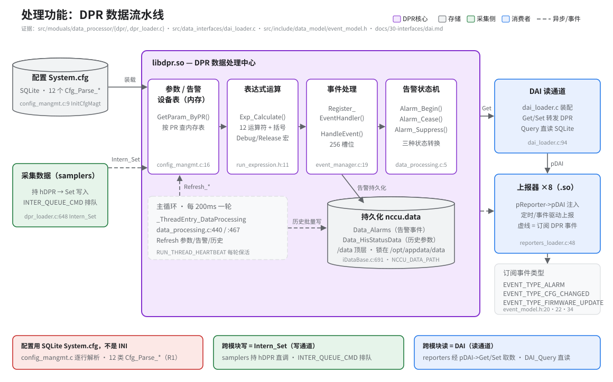

# 处理功能：DPR 数据流水线

> **性质**：叙述性文档（需求断言以 spec 为准）
> **需求权威源**：[`openspec/specs/data-processor/spec.md`](../../openspec/specs/data-processor/spec.md)（R1–R7）
> **代码事实基线**：[`openspec/.code-facts-snapshot.md`](../../openspec/.code-facts-snapshot.md)（§data-processor）
> **对应提交**：`86f803b5`（最后核对时的代码版本）
> **状态**：🟠 部分

## 读图指引

- 紫色容器是 `libdpr.so` 的四段流水线；左侧两个输入（配置、采集数据），右侧两个输出（DAI 读取、事件订阅）。
- 虚线 = 异步/事件流（Intern_Set 排队写入、事件订阅、历史批量写）；实线 = 装载与同步读取。
- 底部三个结论框是本篇最重要的三件事：配置不是 INI、写通道 Intern_Set、读通道 DAI。

## DPR 是数据枢纽

- 架构位置 samplers → **DPR** → reporters：采样数据在这里完成表达式运算、规则判断和事件处理，生成告警与历史记录，再交上报器取走。
- 加载时机：`LoadModuals` 第 1 步 `Init_CreateDataProcessor`（`src/main/main.c:149`）；DAI 函数指针装配在第 3 步（`main.c:165`），只做指针装配、不加载 .so。
- 桥接层 `dpr_loader.c` 把 `Intern_Get`（`:26`）/ `Intern_Set`（`:648`）挂到 `dataprocessor.Get/Set` 函数指针（`:1486-1487`）。
- 目录内四个子模块的分工：`config_mangmt.c`（配置/查找）、`run_expression.c`（算）、`event_manager.c`（派发与持久化）、`data_processing.c`（刷新与告警状态机）。

## 端到端一次数据旅程

1. samplers 采集到原始值，持 `hDPR` 调 `Intern_Set` 写入 → 命令进 `INTER_QUEUE_CMD` 队列排队。
2. DPR 把值写入内存中的参数/告警/设备表；写入前有 `Check_ParamValue` 做大小与范围校验（`dpr.h:47`）。
3. 主循环每 200ms 跑一轮：状态参数按 `equalExpression` 重算，控制/设置参数按 display/controlable/settable 表达式刷新可用标志。
4. `Refresh_Alarm` 评估告警条件/屏蔽表达式，状态机转换产生 `EVENT_ALARM`，经 `HandleEvent` 派发给订阅者并落库。
5. reporters 按自己的节奏经 DAI `Get` 读取、经事件回调被动接收，最终上报到云平台/本地。

## 配置驱动

- 配置不是 INI 文件：全部配置来自 SQLite 数据库 `/app/config/System.cfg`，由 12 个 `Cfg_Parse_*` 回调逐行解析（`dpr.h:22-33`；快照 §data-processor）。
- 配置规模（DevModel / 设备 / 状态·控制·设置参数 / 告警 / 历史参数等）以代码与快照为准，本文不复制数字。
- 装载入口 `InitCfgMagt`（`config_mangmt.c:9`），运行期查找 `GetParam_ByPR`（`config_mangmt.c:16`，按 `PARAM_TYPE` 分发到状态/控制/设置三张参数表）。
- 单行解析错误只记日志、不影响其他行；错误码见 `CFG_ERRCODE`（`dpr.h:7-14`）。

## 表达式与告警的职责分工

- `run_expression.c` 只负责「算」：`ExpressionParser`（`run_expression.c:1265`）把字符串解析成表达式树，`Exp_Calculate` 宏（`run_expression.h:11`，Debug/Release 双版本）求值，支持 12 种运算符。
- 解析一次、反复求值：调用方首次解析后置 `bParseExpSet=FALSE`，主循环直接用表达式树计算（spec R4 场景「表达式解析」）。
- `data_processing.c` 只负责「判与转」：`Refresh_Alarm`（`data_processing.c:251`）评估 `alarmCondExpression` 与 `alarmMaskExpression`，驱动 `Alarm_Begin` / `Alarm_Cease` / `Alarm_Suppress`（`data_processing.c:5/29/59`）在 ACTIVE / CEASED / SUPPRESSED 三态间转换。
- 主循环 `_ThreadEntry_DataProcessing`（`data_processing.c:440`）每 200ms 一轮（`:467`）：逐设备刷新状态/控制/设置参数 → 逐告警评估 → 逐历史参数落库。

## 两条跨模块通道

- **写通道 = Intern_Set**：samplers 持 `pSampler->hDPR` 直调 DPR（不经过 DAI），经 `INTER_QUEUE_CMD` 排队，共 13 种 `SETTYPE_*`（spec R6）。
- **读通道 = DAI**：reporters 经 `pReporter->pDAI`（`reporters_loader.c:48`）调用，`dai_loader.c` 全部转发给 `dataprocessor.Get/Set`（`dai_loader.c:94`、`:576`）；`DAI_Query`（`:747`）直读 SQLite 历史库。接口契约见 [`docs/30-interfaces/dai.md`](../30-interfaces/dai.md)。
- `Intern_Get` 按 `GETTYPE_*` 分发：SP_RAW/SP_VAR→状态参数、CL_VAR→控制参数、ST_VAR→设置参数、READBACK_VAR→回读值、ALMSTATE→告警状态、METERVALUE_REC→SQLite 查询（spec R6 场景「参数类型查询分发」）。
- 错误统一走 `ERRCDDE_DPR`（14 种错误码，`dataprocessor_model.h`），调用方按枚举判错。

## 事件机制

- **事件订阅**：reporters 通过 `Register_EventHandler`（`event_manager.c:19`，256 槽位表 `s_TableEvHandlers`）订阅 `EVENT_TYPE_ALARM` / `EVENT_TYPE_CFG_CHANGED` / `EVENT_TYPE_FIRMWARE_UPDATE`（`event_model.h:20/22/34`）。
- **派发**：`HandleEvent`（`event_manager.c:404`）遍历 handler 表按 `nEvTypeFlag`/`nMsgTypeFlag` 匹配回调；告警事件额外持久化到 `Data_Alarms`。
- **重启恢复**：`RestoreHisEvent` 从 `Data_Events` 表找回未完成事件（`Event_Status = EVENT_STATUS_OCCUR`），恢复进内存事件队列。

## 持久化与 DB/锁目录分离的坑

- 运行时数据库路径由 `NCCU_DATA_PATH` 决定，默认 `/data/nccu.data`（兜底 `iDataBase.c:691`）。
- **DB 文件在 `/data/` 顶层，而它的锁与索引文件在 `/opt/appdata/data/`**——两者同分区但不同目录，排查"文件找不到"时先看这里。
- 各类记录用 9 个独立循环索引管理编号（事件/告警/充电记录/电表读数/ES 状态/BMS 运行数据/健康数据/kWh/累计数据），写满回绕。
- 历史参数写 `Data_HisStatusData`：值变化超阈值或缓存满才写，`BEGIN TRANSACTION`…`COMMIT` 批量插入，另有 60 秒强制写一次。
- 并发保护是双重机制：publib 的 `flock` 文件锁 + `sqlite3_busy_timeout(20000)`（spec R7）。

## 权威源与延伸阅读

- 需求细节：[`openspec/specs/data-processor/spec.md`](../../openspec/specs/data-processor/spec.md)（R1 配置 / R2 事件 / R3 告警 / R4 表达式 / R5 主循环 / R6 跨模块访问 / R7 数据库安全）。
- 接口契约：[`docs/30-interfaces/dai.md`](../30-interfaces/dai.md)（DAI 结构、转发路径、已知待核实项）。
- 代码事实：[`openspec/.code-facts-snapshot.md`](../../openspec/.code-facts-snapshot.md) §data-processor。
- 结构视图：[`docs/10-architecture/svg/topo-04-dpr-internals.svg`](../10-architecture/svg/topo-04-dpr-internals.svg)（DPR 内部四子模块 + dpr_loader 桥接）。
