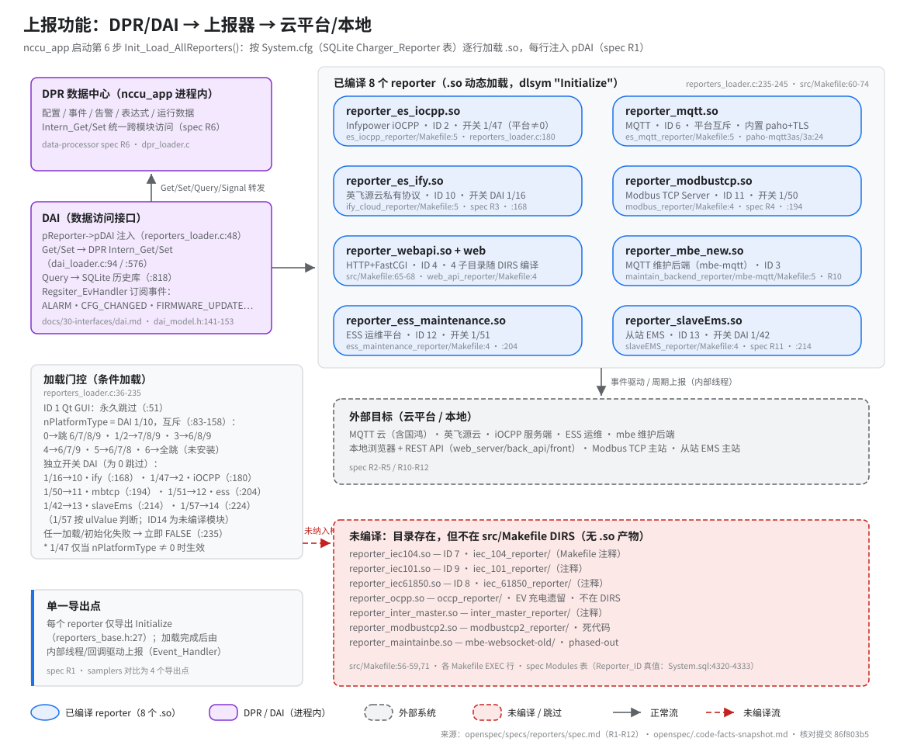

# 数据上报（reporters）

> **性质**：叙述性文档
> **需求权威源**：`openspec/specs/reporters/spec.md`（R1–R12）
> **代码事实基线**：`openspec/.code-facts-snapshot.md`
> **对应提交**：`86f803b5`（最后核对时的代码版本）
> **状态**：🟠 部分

## 上报职责

- 业务数据经 samplers → DPR 处理后，由 8 个已编译上报器通过多协议送到云端、运维平台或本地客户端（spec Purpose；DIRS 见 `src/Makefile:60-74`）。
- 启动第 6 步 `Init_Load_AllReporters()` 按 SQLite 配置表 `Charger_Reporter` 逐行加载 `.so`：`LoadDynamicLibrary` + dlsym 解析 1 个符号 `Initialize`，并注入 `pReporter->pDAI`（`reporters_loader.c:36-48`；符号名 `REPORTER_INIT` 定义于 `reporter_model.h:7`）。
- JSON 序列化统一走 `reporters_base.h` 引入的 cJSON；公共辅助函数在 `reporters_pubfun.c`（`Make_TimeString` / `GetLCCfg_Reporter` / `Reporter_GetCommPort_ById`）。
- `Initialize` 的典型初始化序列（以 es_mqtt 为典型，spec R1）：分配私有数据堆 → 创建互斥锁与消息队列 → 创建工作线程（`RunThread_Create`）→ `pDAI->Regsiter_EvHandler(...)` 订阅事件；此后一切上报由事件回调入队、工作线程消费发送。

## 单一导出点 Initialize 的含义与影响

- 每个 reporter 只导出 1 个函数 `Initialize(HANDLE pReporterThis)`（`reporters_base.h:27`），与 samplers 的 4 个导出点不同。
- 接口面极小：加载器只需 dlsym 1 个符号；新增上报器只需实现 `Initialize`。
- 内部自治：连接、收发、重连全部发生在 `Initialize` 内创建的工作线程/回调中（线程 + 互斥锁 + 消息队列），主进程对其内部状态不可见，出问题只能看各 reporter 自身日志。
- 失败放大：任一 reporter `LoadReporterLib` 失败或 `Initialize` 返回 FALSE，`Init_Load_AllReporters` 立即 `return FALSE`，中断后续所有 reporter 的加载（`reporters_loader.c:235-245`；spec 已记为技术债，与 samplers loader 行为不同）。
- 对比参照：samplers 每个导出 4 个函数（Init/Sample/Control/JigTest），reporter 把其余职责全部内化到单个 `Initialize` 之后的线程/回调里，这是两套动态模块最大的接口差异。

## 互斥跳过与 DAI 开关（“配置驱动”）

- Reporter_ID 真值来自 `Charger_Reporter` 表（`src/config/System.sql:4320-4333`）：`1=QtGUI / 2=ES-iOCPP / 3=mbe_new / 4=WebAPI / 6=MQTT / 7=IEC104 / 8=IEC61850 / 9=IEC101 / 10=ES-Ify / 11=ModbusTCP / 12=EssMaintenance / 13=slaveEMS / 14=ModbusTCP2`，**无 ID 5**；`nReporterID` 即该表主键（`config_mangmt.c:1424`）。
- 平台互斥：`nPlatformType`（DAI 参数 1/10）决定云平台协议族，同一时间只启用一种，关系硬编码在 loader 的 if-else 链中（`reporters_loader.c:83-158`；spec R1）：0(Std)→跳过 6/7/8/9；1/2(MQTT)→7/8/9；3(IEC104)→6/8/9；4(IEC61850)→6/7/9；5(IEC101)→6/7/8；6(未安装)→6/7/8/9。
- ID 1（Qt GUI）无条件跳过，不加载（`reporters_loader.c:51-56`）。
- 独立开关：各 reporter 的 DAI 设置参数（`DAITYPE_SETT_PARAMVALUE_RW`）读取值为 0 则跳过该行加载——1/16→ID10（`:168`）、1/47→ID2（`:180`，仅当 nPlatformType≠0）、1/50→ID11（`:194`）、1/51→ID12（`:204`）、1/42→ID13（`:214`）、1/57→ID14（`:224`，按 `valGet.val.ulValue` 判断，是 loader 中唯一的非 `emValue` 判定）。
- ⚠ 开关↔ID 配对以 loader 代码为准：spec R1 独立开关表及 R5/R10/R12 行文将 1/47 记为 WebAPI(ID4)、1/51 记为 mbe(ID3)、1/50 记为 EssMaintenance(ID12)、1/57 记为 iOCPP(ID2)，与 `reporters_loader.c:168-227` 的硬编码判定不一致；ID3/ID4 在当前代码中没有独立开关。spec 待修正，本文按代码陈述。
- 开关语义：这些参数存于配置库的设置参数区，运行期可经 Web/云通道改写，重启后生效；参数均为 `devID=1` + paramID，经 DAI `Get` 读取（spec R3/R5/R10/R11/R12 分别记载了 1/16、1/47、1/51、1/42、1/57 的意图）。

> 图中 pill 的开关标签按 loader 代码的 ID 配对标注；引用 spec 行文（R3/R5/R10/R11/R12）时注意上述 ⚠ 出入。

已编译 8 个 `.so` 一览（`EXEC =` 行 + 配置 ID + 开关）：

| `.so` | ID | 协议 / 目标 | 独立开关 | spec |
|-------|:--:|-------------|----------|:----:|
| `reporter_es_iocpp.so` | 2 | Infypower 私有 iOCPP | 1/47（平台≠0） | R12 |
| `reporter_mqtt.so` | 6 | MQTT（内置 paho+TLS，含国鸿数字能源云） | 仅平台互斥 | R2 |
| `reporter_es_ify.so` | 10 | 英飞源云私有协议 | 1/16 | R3 |
| `reporter_modbustcp.so` | 11 | Modbus TCP Server（libmodbus） | 1/50 | R4 |
| `reporter_webapi.so`（+ web_server/back_api/front） | 4 | 本地 Web + REST API | —（R5 行文记 1/47 ⚠） | R5 |
| `reporter_mbe_new.so` | 3 | 维护后端 MQTT 通道 | —（R10 行文记 1/51 ⚠） | R10 |
| `reporter_ess_maintenance.so` | 12 | ESS 运维平台 | 1/51 | R10 |
| `reporter_slaveEms.so` | 13 | 从站 EMS | 1/42 | R11 |

## 已编译 vs 未编译（易误判）

- 已编译 8 个 `.so`：上表所列；DIRS 见 `src/Makefile:60-74`，产物名见各 Makefile `EXEC =` 行。web_reporter 复合模块另产 3 个非 reporter 产物：`web_server` 可执行文件、`web_main.api` FastCGI 后端、`front/` 静态资源（`web_reporter/*/Makefile`）。
- MQTT 链接内置 paho 客户端：`-lpaho-mqtt3as -lpaho-mqtt3a`（`es_mqtt_reporter/Makefile:24`）。
- 未编译 7 个（目录与 `EXEC =` 行都在，但不在 DIRS）：`reporter_iec104.so`(ID7) / `reporter_iec101.so`(ID9) / `reporter_iec61850.so`(ID8)（`src/Makefile:57-59` 注释）、`reporter_ocpp.so`（EV 充电遗留，不在 DIRS）、`reporter_inter_master.so`（`src/Makefile:56` 注释）、`reporter_modbustcp2.so`（死代码，不在任何 Makefile）、`reporter_maintainbe.so`（`mbe-websocket-old`，`src/Makefile:71` 注释，phased-out）。
- 易误判点：目录存在 ≠ 参与构建；`Charger_Reporter` 表中的 ID7/8/9/14 行在运行期要么被互斥/开关跳过，要么因 `.so` 缺失而触发“加载失败→中断全部”。
- MQTT 双向 TLS 证书路径 `/app/config/cacert.pem` / `client.pem` / `client.key`；消息经 `hqMsg2Sent` 队列由工作线程发布（spec R2）。
- ESS 运维上报复用 `web_reporter/back_api/web_data_model.h` 的数据模型（非 MQTT，spec R10）；slaveEMS 支持分时段参数（充放电策略/SOC/功率限制）上报（spec R11）。
- IEC 族（104/101/61850）面向电力主站、OCPP 面向 EV 充电桩后台——两者当前都未编译，见图中红色虚线簇。
## 与 DAI/DPR 的读通道关系

- DAI 是 nccu_app 进程内的函数指针包装层：`Get/Set` 转发 DPR 的 `Intern_Get/Intern_Set`（`dai_loader.c:94`、`:576`；data-processor spec R6），`Query` 直接读运行数据 SQLite 库（`dai_loader.c:818`）。
- 调用方只有 reporters：加载器给每个 reporter 注入 `pReporter->pDAI`（`reporters_loader.c:48`）；samplers 不经过 DAI，拿 `pSampler->hDPR` 直连 DPR（`docs/30-interfaces/dai.md`）。
- 事件方向相反：reporter 在 `Initialize` 里通过 `Regsiter_EvHandler` 订阅 `EVENT_TYPE_ALARM` / `EVENT_TYPE_CFG_CHANGED` / `EVENT_TYPE_FIRMWARE_UPDATE` / `EVENT_TYPE_DIAGNOSTIC_UPLOAD` / `EVENT_TYPE_SYSTEM_EXIT` 等，由 DPR 事件机制回调 `Event_Handler` 驱动上报（spec R1/R2）。
- 读多写少：reporter 主要用 `DAI_Get` 取参数/告警/运行值、`DAI_Query` 查历史记录，`DAI_Set` 用于执行云平台下行的参数写入。

## 相关文档

- 接口细节：[`docs/30-interfaces/dai.md`](../30-interfaces/dai.md)（DAI 原型、转发链、Query 语义）。
- 需求与场景：[`openspec/specs/reporters/spec.md`](../../openspec/specs/reporters/spec.md)（R1–R12 全量）、[`openspec/specs/data-processor/spec.md`](../../openspec/specs/data-processor/spec.md) R6（Intern_Get/Set 跨模块访问）。
- 速查：[`openspec/.code-facts-snapshot.md`](../../openspec/.code-facts-snapshot.md)（reporters 段：8 个逻辑 reporter、DLLExport、条件加载）。
