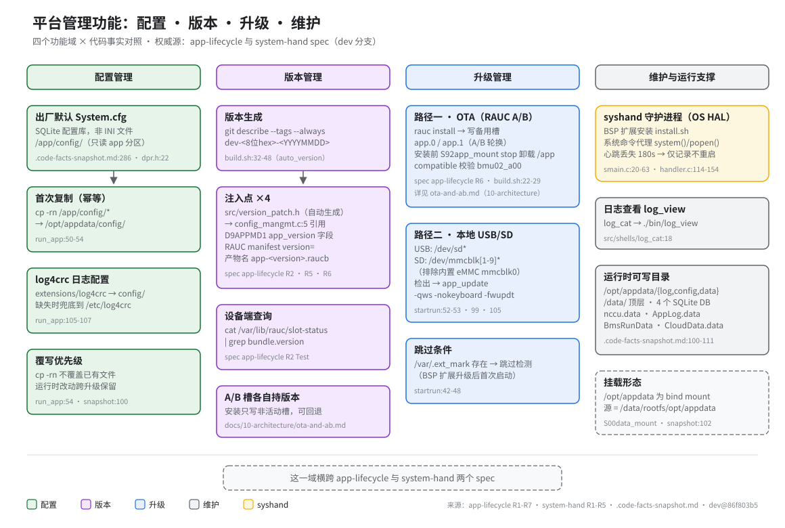

# 平台管理功能（配置 · 版本 · 升级 · 维护）

> **性质**：叙述性文档（读图指引 + 扩展说明）
> **需求权威源**：[`openspec/specs/app-lifecycle/spec.md`](../../openspec/specs/app-lifecycle/spec.md)、[`openspec/specs/system-hand/spec.md`](../../openspec/specs/system-hand/spec.md)
> **代码事实基线**：[`openspec/.code-facts-snapshot.md`](../../openspec/.code-facts-snapshot.md)
> **对应提交**：`86f803b5`
> **状态**：🟠 部分

## 读图顺序

图按四个功能域纵向展开：配置管理 → 版本管理 → 升级管理 → 维护与运行支撑。每列自上而下是
「事实节点 + 代码出处（`file:line` 淡色标签）」；黄色节点是 syshand 守护进程，虚线框表示跨域
注记。底部横条提示：这一域横跨 app-lifecycle 与 system-hand 两个 spec。

## 域 ↔ spec ↔ 代码映射

| 功能域 | spec 依据 | 主要代码位置 |
|---|---|---|
| 配置管理 | app-lifecycle R7（run_app 场景） | `src/shells/run_app:50-54,105-107`、`src/moduals/data_processor/dpr/` |
| 版本管理 | app-lifecycle R2 / R5 / R6 | `build.sh:32-48`、`scripts/sign_metadata.sh`、`scripts/ota-bundle.sh` |
| 升级管理 | app-lifecycle R6 / R7 | `scripts/ota-bundle.sh`、`src/shells/startrun:42-119` |
| 维护与运行支撑 | system-hand R1-R5 | `src/utilities/system_hand/`、`src/shells/log_cat:18` |

## 为什么把配置 / 版本 / 升级 / 维护归为一域

- 四者共同回答同一个问题：「设备上的 /app 从哪来、怎么变、坏了怎么办」——它们都不是业务逻辑，
  而是围绕 app 镜像生命周期的支撑能力。
- 代码分散在 `build.sh`、`scripts/`、`src/shells/`、`src/utilities/system_hand/` 四处，归成一域
  便于对照阅读；构建与部署细节另见 `50-build-deploy/`，日常启停操作另见
  [lifecycle.md](../60-operations/lifecycle.md)。

## 配置：出厂默认 vs 运行时覆写

- 出厂默认是 SQLite 配置库 `/app/config/System.cfg`（非 INI 文件，快照
  `.code-facts-snapshot.md:286`）；`Cfg_Parse_*` 系列解析器全部经 `sqlite3_column_*` 读取
  （`dpr.h:22-33`），业务语义归 data-processor spec。
- `/app` 分区只读且随镜像整体更换，因此可写副本放在 `/opt/appdata/config/`：`run_app:50-54`
  建目录后用 `cp -rn` 幂等复制——`-n` 不覆盖已有文件，运行时改动得以跨升级保留。
  ⚠️ 但该覆写副本**只对 `log4crc` 生效**：`System.cfg` 并不从 `/opt/appdata/config/` 读取（DPR 读的是
  `/app/config/System.cfg`，`NCCU_APP_PATH` 从未设置→回退 `.`），详见 [`40-configuration/system-cfg.md`](../40-configuration/system-cfg.md)。
- 日志配置 `log4crc` 同理：`run_app:105-107` 从 `/app/extensions/` 复制到
  `/opt/appdata/config/`，缺失时兜底复制到 `/etc/log4crc`。

## 版本：一次生成，四处注入

- 版本号由 `git describe` 在 `build.sh:32-48` 自动生成（无 tag 时为 `dev-<8位hex>-<YYYYMMDD>`），
  随后注入四个位置：`src/version_patch.h`（被 `config_mangmt.c:5` 引用进二进制）→ D9APPMD1
  元数据 `app_version` 字段（`sign_metadata.sh`）→ RAUC manifest `version=`（`ota-bundle.sh`）
  → 产物文件名 `app-<version>.raucb`。
- 设备端核对槽位版本：`cat /var/lib/rauc/slot-status | grep bundle.version`
  （app-lifecycle R2 Test）。
- 注入是单向的：版本源只在构建期生成，重构建即可复现，不依赖手工同步。

## 升级：两条路径的取舍

- **OTA（RAUC A/B）**：`rauc install` 只写备用槽（app.0 / app.1），活动槽保持可回退；安装前
  需先 `S92app_mount stop` 卸载 `/app`（app-lifecycle R6）。bundle 带
  `compatible=bmu02_a00` 校验（`build.sh:22-29`），整机链路见
  [ota-and-ab.md](../10-architecture/ota-and-ab.md)。
- **本地（USB/SD）**：`startrun` 在启动早期检测可移动介质并进入 `app_update -qws -nokeyboard
  -fwupdt` 升级模式（`startrun:52-53,99,105`）。SD 检测用 `mmcblk[1-9]*` 而非 `mmc*`，避免把
  内置 eMMC `mmcblk0` 误判成 SD 卡（app-lifecycle R7 附注，2026-07 修正）。
- 取舍：OTA 有签名校验与槽位回退，适合受控发布；本地路径绕过 RAUC，适合产线刷机与现场救急，
  但没有回退保障。`/var/.ext_mark` 存在时跳过本地检测（`startrun:42-48`，BSP 扩展升级后的
  首次启动直接进入应用）。

## syshand 的定位：OS HAL，不是业务逻辑

- syshand 是 OS 系统调用抽象层，承担三件事：BSP 扩展安装（`smain.c:20-63`）、系统命令代理
  （`handler.c:139-152`）、心跳监控（`handler.c:114-125`）。
- 心跳丢失 180s（18 × 10s 窗口）后仅记录日志并继续服务，不重启系统、不退出进程
  （system-hand R1，2026-09-16 确认为既定设计而非调试试态）。应用故障不重启整机，
  重启应用的职责归上层保活机制（BSP `app_sysmgr`，app-lifecycle R10）。
- 维护入口：日志查看经 `log_cat` 包装 `./bin/log_view`（`log_cat:18`）；运行时可写目录与
  SQLite DB 布局见快照 `.code-facts-snapshot.md:100-111`（`/opt/appdata` 是 bind mount，
  源为 `/data/rootfs/opt/appdata`）。

## 边界与关联

- 本域横跨 app-lifecycle 与 system-hand 两个 spec；配置的业务语义（参数含义、告警规则）归
  data-processor spec，本篇只讲「配置文件从哪来、怎么覆写」。
- 配置项明细与覆写清单见 [`40-configuration/system-cfg.md`](../40-configuration/system-cfg.md)、[`device-model-and-params.md`](../40-configuration/device-model-and-params.md)、[`i18n.md`](../40-configuration/i18n.md)。
