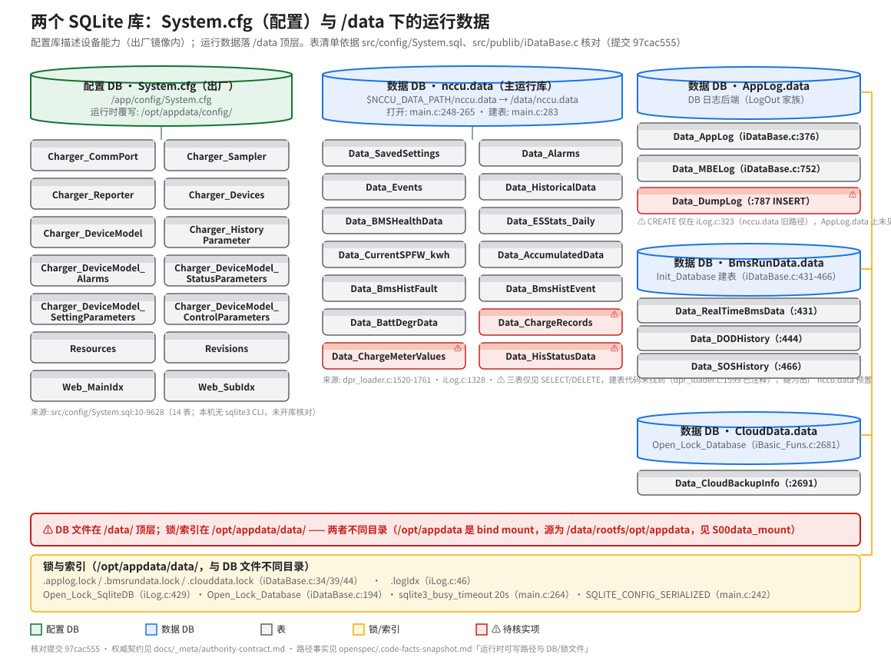

> **性质**：接口契约
> **需求权威源**：`openspec/specs/data-processor/spec.md`（R1 配置管理 / R7 SQLite 数据库安全）+ `openspec/specs/publib/spec.md`（R2 DB 日志 / R6 数据库封装）
> **代码事实基线**：`openspec/.code-facts-snapshot.md`（「运行时可写路径与 DB/锁文件」）
> **对应提交**：`97cac555`
> **状态**：🟠 部分（⚠️ 表清单部分待核实，见下）

# SQLite Schema（两个库 + 表 + 锁/索引）

## 两个库的分工

| 库 | 文件 | 角色 |
|---|---|---|
| 配置库 | `/app/config/System.cfg`（出厂，只读镜像内）；`/opt/appdata/config/` 有 `cp -rn` 覆写副本但 **System.cfg 不从中读取**（仅 `log4crc` 生效，见 [40-configuration/system-cfg.md](../40-configuration/system-cfg.md)） | 描述设备能力：端口/采样器/上报器/设备型号/参数/告警/Web 索引。装载入口 `InitCfgMagt`（`config_mangmt.c`，spec data-processor R1） |
| 数据库 ×4 | `$NCCU_DATA_PATH/nccu.data`（运行时 `/data/nccu.data`，`main.c:248-265`）+ `AppLog.data` / `BmsRunData.data` / `CloudData.data`（`InitCreatDataBase`，`iDataBase.c:59`） | 运行期业务数据与日志。路径由 `NCCU_DATA_PATH` 决定，缺失时硬编码兜底 `/data`（`iDataBase.c:691`） |

注意：`System.cfg` 虽无 `.db` 后缀，实为 SQLite 文件（由 SQLiteStudio 导出的 `src/config/System.sql` 即其 schema dump）。DB 文件名与路径常量：`charger_model.h:99`（`CHARGER_CONFIG_DB`）。

## 配置库表（14 张，均在 `src/config/System.sql` 核实）

| 表 | 用途 | System.sql 行 |
|---|---|---|
| `Charger_CommPort` | 通信端口定义（`Port_Driver` 指向 `libcomm_*.so`） | :10 |
| `Charger_Sampler` | 采样器实例配置 | :4335 |
| `Charger_Reporter` | 上报器实例配置 | :4319 |
| `Charger_Devices` | 设备实例（外键 → 型号、采样器） | :4205 |
| `Charger_DeviceModel` | 设备型号字典 | :33 |
| `Charger_DeviceModel_Alarms` | 告警定义（发生/屏蔽条件表达式） | :59 |
| `Charger_DeviceModel_StatusParameters` | 状态参数（`Data_Source`/`Equal_Expression`） | :2244 |
| `Charger_DeviceModel_SettingParameters` | 设置参数（默认值/可设表达式） | :1325 |
| `Charger_DeviceModel_ControlParameters` | 控制参数（可控表达式） | :1181 |
| `Charger_HistoryParameter` | 历史参数配置 | :4316 |
| `Resources` | 多语言文本资源（`Name_Res`/`Unit_Res` 外键目标） | :4352 |
| `Revisions` | 配置/软件版本记录 | :9569 |
| `Web_MainIdx` / `Web_SubIdx` | Web 页面参数主/子索引（参数表的 `Web_Main`/`Web_Sub` 外键目标） | :9604 / :9628 |

System.sql 中未定义任何 `CREATE INDEX`（已核对，grep 为空）。

## 数据库表（按 DB 文件分组，代码核实）

### `/data/nccu.data`（主运行库；建表 `Init_CreadDataDB`，`dpr_loader.c:1512`，调用点 `main.c:283`）

| 表 | 用途 | 代码位置 |
|---|---|---|
| `Data_SavedSettings` | 参数持久化（主键 Device_Id+Param_Id） | `dpr_loader.c:1520` |
| `Data_Alarms` | 告警发生/恢复记录 | `dpr_loader.c:1582`；读写 `event_manager.c:441/475` |
| `Data_Events` | 事件记录（恢复断点用） | `dpr_loader.c:1634`；读写 `event_manager.c:212/233` |
| `Data_HistoricalData` | 历史数据 | `dpr_loader.c:1650` |
| `Data_BMSHealthData` | BMS 健康数据 | `dpr_loader.c:1665` |
| `Data_ESStats_Daily` | 储能统计（日） | `dpr_loader.c:1679` |
| `Data_CurrentSPFW_kwh` | 当前 SPFW 电度 | `dpr_loader.c:1704` |
| `Data_AccumulatedData` | 累计量数据 | `dpr_loader.c:1730` |
| `Data_BmsHistFault` / `Data_BmsHistEvent` | BMS 历史故障/事件 | `dpr_loader.c:1744/1761` |
| `Data_BattDegrData` | 电池退化日志（`LogOut_BattDegr`） | `iLog.c:1328` |
| ⚠️ `Data_ChargeRecords` | 充电记录；**建表代码已注释**（`dpr_loader.c:1599/1613`），仅有 SELECT/DELETE（`dai_loader.c:770`、`st_batt_testmode.c:31`、`rundata_exchange.c:2474`）→ 疑为出厂 nccu.data 预置，未核实 | — |
| ⚠️ `Data_ChargeMeterValues` | 充电电表读数；仅见 SELECT/DELETE（`dai_loader.c:825`、`rundata_exchange.c:2838`），无 CREATE | — |
| ⚠️ `Data_HisStatusData` | 历史状态数据；仅见 SELECT（`rundata_exchange.c:2796`），无 CREATE | — |

⚠️ 遗留路径：`Init_LogRepo`（`main.c:302→:123`，传入 nccu.data 句柄）也会在 nccu.data 上创建 `Data_AppLog`/`Data_DumpLog`（`iLog.c:249/323`）——与 AppLog.data 中的同名表并存，属历史包袱。

### `/data/AppLog.data`（DB 日志后端，LogOut 家族；publib spec R2）

| 表 | 用途 | 代码位置 |
|---|---|---|
| `Data_AppLog` | 应用日志（循环上限 `APP_LOG_SIZE`=10000，`iLog.h:40`） | CREATE `iDataBase.c:376`；INSERT `:540/607/715` |
| `Data_MBELog` | MBE 事件日志（上限 500，`iDataBase.c:20`） | `iDataBase.c:752/1080` |
| ⚠️ `Data_DumpLog` | 数据转储日志；AppLog.data 上仅见 INSERT（`iDataBase.c:787`），CREATE 仅存在于 nccu.data 旧路径（`iLog.c:323`） | — |

### `/data/BmsRunData.data`（`Init_Database` 建表）

| 表 | 用途 | 代码位置 |
|---|---|---|
| `Data_RealTimeBmsData` | BMS 实时运行数据 | `iDataBase.c:431` |
| `Data_DODHistory` | DOD 历史记录 | `iDataBase.c:444` |
| `Data_SOSHistory` | SOS 历史记录 | `iDataBase.c:466` |

- `Data_CloudBackupInfo`：云端备份信息（BLOB）— `iBasic_Funs.c:2691`（经 `Open_Lock_Database(DB_TYPE_CLOUDDATA)` `:2681`）

## 锁与索引（`/opt/appdata/data/`，与 DB 文件不同目录）

- 每 DB 一把文件锁：`.applog.lock` / `.bmsrundata.lock` / `.clouddata.lock`（`iDataBase.c:34/39/44`）+ 每 DB 一把 `pthread_mutex_t`（publib spec R6）。
- 日志索引持久化：`.logIdx`（`iLog.c:46`）；恢复逻辑 `Get_LogIdx_FromVar`（`iDataBase.c:312`）。
- 顶层目录事实（含 bind mount 拓扑）见 `.code-facts-snapshot.md`「运行时可写路径与 DB/锁文件」。

## 访问方式

- nccu.data：`Open_Lock_SqliteDB` / `Close_UnLock_SqliteDB`（`iLog.c:429/509`，可重入线程锁封装）；三个受管 DB：`Open_Lock_Database` / `Close_UnLock_Database`（`iDataBase.c:194/254`）。
- busy timeout 统一 20s：`sqlite3_busy_timeout(db, 20000)`（`main.c:264`、`iLog.c:222`、`InitCreatDataBase` 内同值）；线程模式 `sqlite3_config(SQLITE_CONFIG_SERIALIZED)`（`main.c:242`）。

## 版本与兼容性

- schema 变更需同步本文与图（触发条件见 `docs/_meta/authority-contract.md` 更新表）。
- ⚠️ 三张无建表代码的表（ChargeRecords/ChargeMeterValues/HisStatusData）依赖出厂 nccu.data 镜像内容，重建空库时行为未定义——需真机核实后补充。
