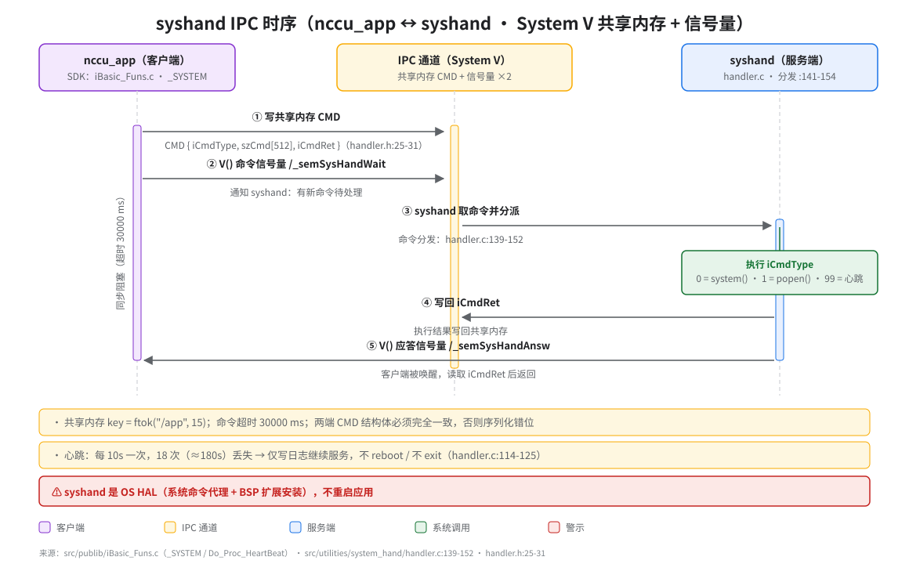

# syshand IPC（system-hand 客户端 ↔ 服务端）

> **性质**：接口契约
> **需求权威源**：`openspec/specs/system-hand/spec.md`（R1 心跳 / R5 PID 文件语义）
> **代码事实基线**：`openspec/.code-facts-snapshot.md`
> **对应提交**：`d4b0055b`
> **状态**：🟠 部分

## 图

## 调用方 / 被调方

| 角色 | 进程 / 模块 | 代码位置 |
|------|------------|---------|
| 调用方（客户端） | `nccu_app` 主进程 | `src/publib/iBasic_Funs.c`（`_SYSTEM` / `Do_Proc_HeartBeat`） |
| 被调方（服务端） | `syshand` 守护进程 | `src/utilities/system_hand/handler.c`（分发 `handler.c:139-152`） |
| 通道 | System V 共享内存 + 命名信号量 | 结构体 `handler.h:25-31` |

## IPC 消息格式

命令结构体 `CMD`（`handler.h:25-31`），两端定义必须完全一致：

| 字段 | 类型 | 语义 | 服务端分派 |
|------|------|------|-----------|
| `iCmdType` | int | 命令类型 | `0` → `system()`；`1` → `popen()`；`99` → 心跳 |
| `szCmd[512]` | char[512] | 命令字符串 / 心跳负载 | 交由 `system()` / `popen()` 执行 |
| `iCmdRet` | int | 执行返回码 | 服务端写回，客户端读取 |

配套 IPC 对象：

| 对象 | 标识 | 说明 |
|------|------|------|
| 共享内存 | `_KEY_T_SYSHAND = ftok("/app", 15)` | 承载 `CMD` 结构体 |
| 命令信号量 | `/_semSysHandWait` | 客户端 `V()` 通知 syshand 取命令 |
| 应答信号量 | `/_semSysHandAnsw` | syshand `V()` 唤醒客户端 |

## 语义与约束

- 同步阻塞：客户端发出命令后等待应答，命令超时 **30000 ms**（`_SYSTEM_LOCK_WAIT_TIMEOUT`）。
- 信号量配对：先写共享内存、后 `V()` 命令信号量；服务端先写回 `iCmdRet`、后 `V()` 应答信号量。
- 结构体一致：两端 `CMD` 不一致会导致序列化错位。
- 命令分流：`iCmdType` 在 `handler.c:139-152` 分流（`0=system()` / `1=popen()` / `99=心跳`）。
- 通道属性：System V 共享内存 + 命名信号量，命令 / 应答各一把。

## 心跳机制

- 客户端周期发送：每 **10s** 一次（18 × 10s 窗口）。
- 丢失阈值：累计 **≈180s** 判定心跳丢失。
- 丢失后行为：**仅记录日志并继续服务**（`no reboot, no exit`，`handler.c:114-125`）；应用故障不重启整机。
- 职责边界：syshand 是 OS HAL（系统命令代理 + BSP 扩展安装），不承担应用保活；重启应用归未来 `app-supervision`。

## 代码位置

| 项 | 位置 |
|----|------|
| 客户端 SDK | `src/publib/iBasic_Funs.c`（`_SYSTEM` / `Do_Proc_HeartBeat`） |
| 服务端命令分发 | `src/utilities/system_hand/handler.c:139-152` |
| 心跳丢失处理 | `src/utilities/system_hand/handler.c:114-125` |
| `CMD` 结构体 | `src/utilities/system_hand/handler.h:25-31` |
| 共享内存 key | `ftok("/app", 15)` |
| 命令超时 | 30000 ms |
