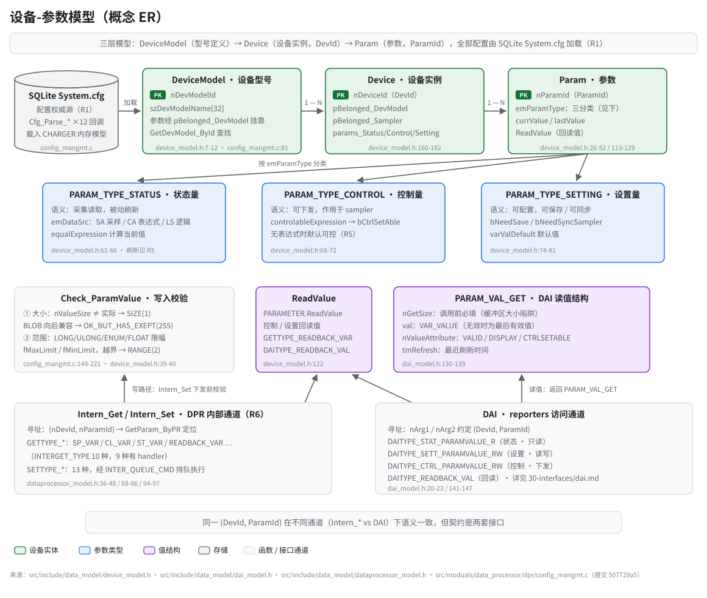

# 设备-参数模型（DeviceModel / Device / Param）

> **性质**：叙述性文档 / 接口契约
> **需求权威源**：`openspec/specs/data-processor/spec.md`（R1/R3/R5/R6）
> **代码事实基线**：`openspec/.code-facts-snapshot.md`
> **对应提交**：`507729a5`
> **状态**：🟠 部分

## 读图指引

- **三层模型（型号 / 实例 / 参数）**：配置加载自 SQLite `/app/config/System.cfg`（R1），由 12 个 `Cfg_Parse_*` 回调解析进内存 `CHARGER` 模型（`config_mangmt.c`）。`DEVICE_MODEL_INFO`（`nDevModelId` + `szDevModelName[32]`，`device_model.h:7-12`）定义型号；`DEVICE`（`nDeviceId` 即 DevId，`device_model.h:160-182`）是实例，每个实例持有三张参数表 `params_Status` / `params_Control` / `params_Setting`（`device_model.h:176-178`）；`PARAMETER`（`nParamId` 即 ParamId，`device_model.h:113-129`）通过 `pBelonged_DevModel` 挂靠回型号（`device_model.h:34`）。
- **三类参数的语义差异**：`PARAM_TYPE_STATUS` 状态量 = 采集读取，被动刷新，数据源 `emDataSrc` 为 SA（采样）/ CA（表达式）/ LS（逻辑设置），由 `equalExpression` 计算当前值（`device_model.h:61-66`，刷新流程见 R5）；`PARAM_TYPE_CONTROL` 控制量 = 可下发到 sampler 执行，`controlableExpression` 决定 `bCtrlSetAble`，无表达式时默认可控（`device_model.h:68-72`）；`PARAM_TYPE_SETTING` 设置量 = 可配置，支持保存与向 sampler 同步（`bNeedSave` / `bNeedSyncSampler`），带默认值 `varValDefault`（`device_model.h:74-81`）。
- **值结构约定**：DAI 读值返回 `PARAM_VAL_GET`（`dai_model.h:130-139`）—— `nGetSize` 由调用方在调用前填好缓冲区大小（常见陷阱：漏填导致长度校验失败），`val` 在值无效时携带最后有效值；`PARAMETER.ReadValue`（`device_model.h:122`）是控制 / 设置参数的回读值，`Intern_Get` 的 `GETTYPE_READBACK_VAR` 与 DAI 的 `DAITYPE_READBACK_VAL` 均取自此字段。
- **校验与范围**：写入路径经 `Check_ParamValue`（`config_mangmt.c:149-221`）—— 先比大小（`nValueSize` 不符返回 `ERR_PARAMVAL_SIZE(1)`；BLOB 向后兼容场景放行为 `ERR_PARAMVAL_OK_BUT_HAS_EXEPT(255)`），再对 LONG / ULONG / DATETIME / ENUM / FLOAT 按 `fMaxLimit` / `fMinLimit`（`device_model.h:39-40`）做范围检查，越界返回 `ERR_PARAMVAL_RANGE(2)`，BLOB 另查 `blobType` 合法区间。
- **与 DAI 的关系**：DPR 内部通道 `Intern_Get` / `Intern_Set`（`dataprocessor_model.h:50-55 / 94-97`）与 reporters 使用的 DAI 通道（`dai_model.h:20-23 / 141-147`）是**两套契约**，但都以 `(DevId, ParamId)` 寻址同一参数表，语义一致；DAI 侧细节见 [`../30-interfaces/dai.md`](../30-interfaces/dai.md)。

## 查找与告警联动

- `GetParam_ByPR(PARAM_TYPE, nDevId, nParamId)` 先遍历设备匹配 DevId，再按 `emType` 分发到对应参数表匹配 ParamId，未找到返回 `NULL`（`config_mangmt.c:16-52`）。
- 告警同样按 `(DevId, AlarmId)` 查找：`GetAlarm_ByPR`（`config_mangmt.c:54-79`，R3）；告警可携带扩展参数 `ALARM_INFO.nExValue_ParamId`（`device_model.h:99`），运行时经 `GetParam_ByPR(PARAM_TYPE_STATUS, …)` 关联到本设备参数（`config_mangmt.c:1779`）。

## 相关需求

- R1 配置管理：SQLite 加载与 `Cfg_Parse_*` 机制 —— `openspec/specs/data-processor/spec.md`（R1）
- R3 告警管理：告警生命周期与参数联动 —— 同上（R3）
- R5 数据处理主循环：三类参数的周期刷新语义 —— 同上（R5）
- R6 跨模块数据访问：`Intern_Get` / `Intern_Set` 契约 —— 同上（R6）

## 维护提示

- 参数 ID / 模块数量等数字以代码与 `openspec/.code-facts-snapshot.md` 为准；本页引用均带 `file:line`，代码变更时同步更新。
- `GETTYPE_CHARGE_REC` 已在 `INTERGET_TYPE` 枚举中定义但无 handler（`dataprocessor_model.h:43`），新增枚举时注意同步本图。
