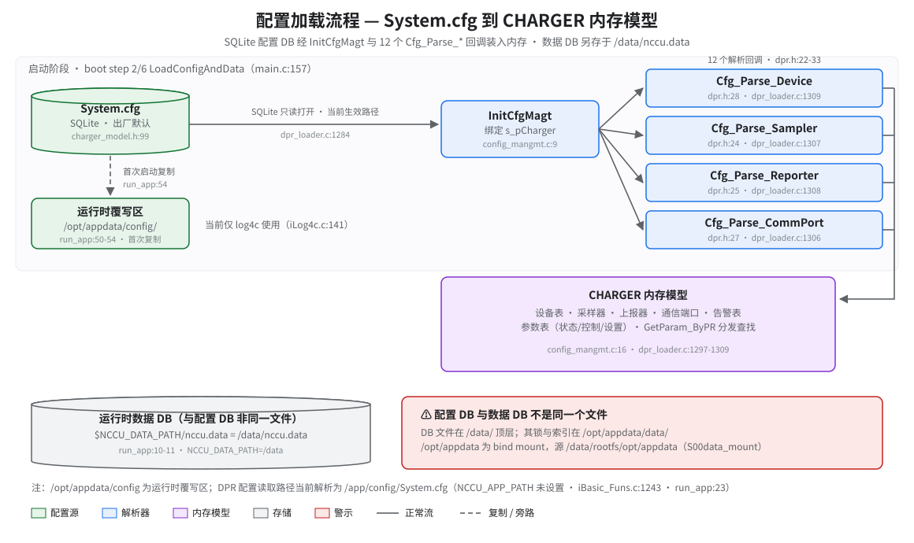

# System.cfg — 配置加载机制

> **性质**：叙述性文档
> **需求权威源**：`openspec/specs/data-processor/spec.md`（R1 配置管理）
> **代码事实基线**：`openspec/.code-facts-snapshot.md`
> **对应提交**：`507729a5`
> **状态**：🟠 部分

## 这张图回答什么

一份 `System.cfg` 如何在启动时变成内存里的设备、参数、告警表；为什么磁盘上有两个"配置相关"的目录、`/data` 下还有一个长得像配置的 DB——以及哪些坑在等首次读代码的人。

## 核心机制：配置驱动

整套设备行为由一个 SQLite 数据库驱动，不是 INI 文件：

- 配置 DB：`/app/config/System.cfg`（SQLite，宏 `CHARGER_CONFIG_DB` 定义于 `charger_model.h:99`）
- 打开方式：`sqlite3_open_v2(..., SQLITE_OPEN_READONLY, NULL)`，只读（`dpr_loader.c:1284-1285`）
- 入口：`InitCfgMagt(HANDLE hCharger)` 记录静态指针 `s_pCharger`（`config_mangmt.c:9-12`）
- 解析回调：共 12 个 `Cfg_Parse_*`，原型 `CFG_ROW_PARSER`，声明于 `dpr.h:22-33`
- 全部经 `sqlite3_column_*` 读表，逐行解析，单行出错仅记日志，不拖垮其他行

## 出厂默认与运行时覆写

- `/app` 是 dm-verity 只读分区，改配置不能就地改 `/app/config/`——这就是"复制一份到可写区"的原因
- `run_app:50-54`：`mkdir -p /opt/appdata/config` 后 `cp -rn /app/config/* /opt/appdata/config/`，`-n` 保证幂等，只补缺不覆盖
- ⚠️ **现状**：DPR 的读取路径是 `getenv("NCCU_APP_PATH") + "config" + "System.cfg"`（`dpr_loader.c:1283-1285`），而 `NCCU_APP_PATH` 从未被设置，`MakeFullFileName` 对空值回退 `"."`（`iBasic_Funs.c:1243`），配合 `run_app:23` 的 `cd /app`，实际解析为 `/app/config/System.cfg`
- 因此 `/opt/appdata/config/` 目前只被 log4c 使用（`iLog4c.c:141`），尚未接管 System.cfg 的读取

## 四个解析器与它们的对象

`System.cfg` 表名 → 解析回调 → 内存对象的对应关系（接线表在 `dpr_loader.c:1297-1309`）：

| System.cfg 表 | 解析回调 | 装入内存 |
|---|---|---|
| `Charger_Devices` | `Cfg_Parse_Device`（`dpr.h:28`） | `pCharger->devices` 设备表 |
| `Charger_Sampler` | `Cfg_Parse_Sampler`（`dpr.h:24`） | `pCharger->samplers` 采样器表 |
| `Charger_Reporter` | `Cfg_Parse_Reporter`（`dpr.h:25`） | `pCharger->reporters` 上报器表 |
| `Charger_CommPort` | `Cfg_Parse_CommPort`（`dpr.h:27`） | `pCharger->commports` 通信端口表 |

其余 8 个回调覆盖 Revisions / Resources / DeviceModel / STU/CTR/SET 参数 / Alarms / HisParam（`dpr_loader.c:1297-1304`），共同装满 `CHARGER` 结构。运行期查找统一走 `GetParam_ByPR` 按 `PARAM_TYPE` 分发到状态/控制/设置参数表（`config_mangmt.c:16`）。

## 配置 DB vs 数据 DB

| | 配置 DB | 数据 DB |
|---|---|---|
| 路径 | `/app/config/System.cfg` | `$NCCU_DATA_PATH/nccu.data` = `/data/nccu.data`（`run_app:10-11`） |
| 打开方式 | 只读 | 读写 |
| 内容 | 出厂参数、表结构 | 运行时采集/事件/历史数据 |

坑：两者同分区不同目录——DB 文件在 `/data/` 顶层，而它的锁与索引落在 `/opt/appdata/data/`（`/opt/appdata` 是 bind mount，源 `/data/rootfs/opt/appdata`）。别在 `/opt/appdata/data/` 里找 `nccu.data`。

## 加载时机与失败模式

- 时机：主进程 6 步加载的第 2 步 `LoadConfigAndData`（`main.c:157`），由第 1 步 `Init_CreateDataProcessor` 注册（`dpr_loader.c:1502`）
- 失败即退出，无降级：配置 DB 打不开直接记错误日志并返回 FALSE（`dpr_loader.c:1286-1291`），`Main_LoadModuals` 随之返回 FALSE（`main.c:158-163`），主进程终止
- 单行配置错误 ≠ 加载失败：逐行解析，坏行只记日志（spec R1 Scenario 配置错误处理）

## 陷阱速查

1. 配置 DB 是 SQLite，打开它当文本解析必失败
2. `NCCU_APP_PATH` 未设置——读路径靠 `cd /app` 兜底（`run_app:23`），换启动方式时注意工作目录
3. 改 `/opt/appdata/config/System.cfg` 不会生效，DPR 不从这里读
4. 需求级断言见权威源 R1，本文不复述

## 参考

- 权威需求：`openspec/specs/data-processor/spec.md`（R1 配置管理）
- 代码事实基线：`openspec/.code-facts-snapshot.md` 的 `## data-processor`（Config DB path / Config parsers）
- 配置接线表：`src/moduals/data_processor/dpr_loader.c:1297-1309`
- 运行时可写目录总览：`AGENTS.md` § 运行时可写目录
