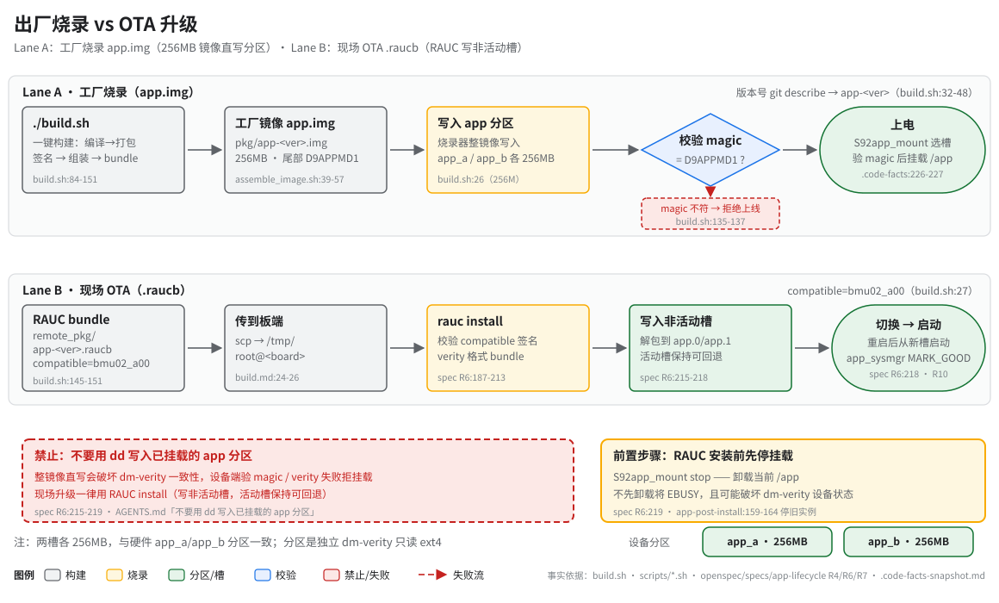

> **性质**：操作手册
> **需求权威源**：[`openspec/specs/app-lifecycle/spec.md`](../../openspec/specs/app-lifecycle/spec.md)（R4/R6/R7）
> **代码事实基线**：[`openspec/.code-facts-snapshot.md`](../../openspec/.code-facts-snapshot.md)
> **对应提交**：`d4b0055b`
> **状态**：🟠 部分

# 出厂烧录 vs OTA 升级



## 两种交付路径的区别

| | 工厂烧录（Lane A） | 现场 OTA（Lane B） |
|---|---|---|
| 产物 | `pkg/app-<ver>.img`（`build.sh:138`） | `remote_pkg/app-<ver>.raucb`（`build.sh:143-151`） |
| 写入方式 | 烧录器整镜像直写 `app_a`/`app_b` 分区 | `rauc install` 写入**非活动槽**（spec R6:215-218） |
| 适用场景 | 空板 / 产线 / 设备无法启动 | 现场已运行设备，不停产升级 |
| 前置条件 | 分区可整片擦写 | 先 `S92app_mount stop` 卸载 `/app`（spec R6:219） |

两槽各 256MB（`build.sh:26` `PARTITION_SIZE="256M"`），与硬件 app_a/app_b 分区一致；每个分区是独立的
dm-verity 只读 ext4。镜像尾部布局为 `[ext4][hashtree][zero][签名][元数据]`，元数据固定在分区尾 4096，
RSA-2048 签名紧邻其前（`assemble_image.sh:39-57`）。

## 工厂烧录步骤与校验

1. `./build.sh` 完整构建：编译 → 打包（ext4/verity/签名/组装）→ RAUC bundle（`build.sh:84-151`）。
2. 取 `pkg/app-<ver>.img`，交烧录器整镜像写入 `app_a`（或 `app_b`）。
3. 写入后校验尾部 magic（`build.sh:135-137`）：

   ```bash
   magic=$(dd if=app.img bs=1 skip=$((256*1024*1024 - 4096)) count=8)
   echo $magic   # 应输出 D9APPMD1
   ```

4. 上电后由设备端 `S92app_mount` 选槽、验 magic、dm-verity open 并只读挂载 `/app`
   （`.code-facts-snapshot.md` `## app-lifecycle` boot 路径块）。
5. block size 校验在构建期已完成：`dumpe2fs -h` 读出值应为 4096（`build.sh:110-112`，dm-verity 兼容要求）。

## 现场 OTA 指针

- 全链路叙述（构建 → 部署 → MARK_GOOD 确认 / 回滚）：[`../10-architecture/ota-and-ab.md`](../10-architecture/ota-and-ab.md)
- 命令速查（scp + `rauc install` + 版本查询）：[`build.md`](build.md)
- `compatible` 一致性问题（mismatch 报错与解法）：[`rauc-compatible.md`](rauc-compatible.md)
- 专项手册 [`rauc-ota.md`](rauc-ota.md)（安装与 slot 切换细节）。

## 禁止事项

- **不要用 `dd` 写入已挂载的 app 分区** —— 会破坏 dm-verity 一致性；现场升级用 `rauc install`。
- RAUC 安装前先 `S92app_mount stop` 卸载 `/app`（spec R6:219），否则卸载失败（EBUSY）。
- 安装链内部会先停旧实例：`pkill -9 app_entry syshand nccu_app`（`app-post-install:159-164`），
  无需也不应手工重复杀进程后直写分区。

## 常见失败

| 现象 | 判据 / 报错 | 处置 |
|---|---|---|
| magic 不符 | 构建端 `错误: metadata magic=…`（`build.sh:137`）；设备端 S92app_mount 拒挂 | 重跑 `./build.sh` 打包；核对读取偏移为分区尾 4096 |
| compatible 不匹配 | `Compatible mismatch: Expected '<device>' but bundle manifest has '<bundle>'` | 以设备 `/etc/rauc/system.conf` 为准设置 `RAUC_COMPATIBLE` 重新构建（见 [rauc-compatible.md](rauc-compatible.md)） |
| 分区未创建 | `S92app_mount` 报 WARNING、`/app` 为空、应用从未启动（EMU01 实测） | BSP 侧确认 app_a/app_b 分区规划；在分区就绪前任何烧录/OTA 均不可用 |

## 维护

图源 [`svg/factory-flashing.svg`](svg/factory-flashing.svg)，风格遵循 [`../_meta/svg-style.md`](../_meta/svg-style.md)；
改动 `build.sh`、`scripts/*.sh` 或 `config/verity.conf` 时复核图中 `file:line`，并回填头部「对应提交」。
