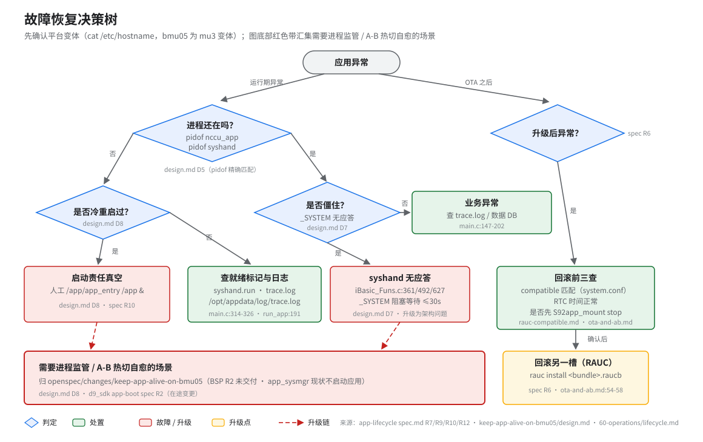

# 应用故障恢复（故障恢复决策树）

> **性质**：操作手册
> **需求权威源**：`openspec/specs/app-lifecycle/spec.md`（R7/R9/R10）+ `openspec/changes/keep-app-alive-on-bmu05/`（design.md D3/D6/D7/D8）
> **代码事实基线**：`openspec/.code-facts-snapshot.md`
> **对应提交**：`97cac555`
> **状态**：🟠 部分



## 前置

- root shell（串口或 SSH）。
- **先判断平台变体**：`cat /etc/hostname`。bmu05 为 mu3 变体，UI 进程名（`nccu_ui` vs `nccu_ui_mm`）与脚本行号存在差异，修复须双变体同步（app-lifecycle R12）。
- 运行日志在 `/opt/appdata/log/trace.log`（`run_app:5`），排查优先看它，不要 grep `AppLog.data`（那是 SQLite 库文件）。⚠️ stdout/stderr 落 trace.log 是**变体相关**的：bmu05（mu3）生效，非 mu3 被注释（`run_app:192`），spec R13 仍要求该重定向（spec-code drift）。

## 场景 A：冷重启后 app 未启动

**症状**：设备重启后 `pidof nccu_app`、`pidof syshand` 均无输出，`/app` 已挂载。

这不是回归，而是启动责任真空（design.md D8）：`S92app_mount` 按设计只挂载不启动，app_sysmgr v2 未编译启动能力（BSP R2 未交付）。人工拉起：

```sh
/app/app_entry /app &
```

app_entry 自带幂等守卫，重复执行安全（`app_entry:21-24`）。唯一会自动拉起应用的路径是 OTA 安装（`app-post-install` 的 `start_app()`）。

## 场景 B：启动卡住（syshand.run 等待超时）

**症状**：trace.log 中 nccu_app 启动后很快退出，无模块加载记录。

nccu_app 启动时轮询 `/opt/appdata/data/syshand.run`，约 10.1s 超时后退出（`main.c:314-326`）。检查顺序：

1. `pidof syshand` —— 无输出则 syshand 没起来（存活判定必须用进程检查，勿信 `ps | grep` 子串匹配的假阳性，design.md D5）；
2. 看 syshand 自身报错与 `/opt/appdata/data/` 下 PID 文件状态；
3. `run_app` 的 syshand 存活检查失败会直接 `exit 0`（`run_app:168-179`）。

## 场景 C：进程僵住（_SYSTEM 阻塞）

**症状**：`pidof nccu_app` 有输出但业务无响应，strace 可见卡在 `_SYSTEM` 调用。

`_SYSTEM` 每次最多阻塞 30s 等待 syshand 应答；syshand 无应答时 `iBasic_Funs.c:361/492/627` `raise(SIGUSR1)` → 应用退出（design.md D7，**不修**：改成只记日志会把「死」变「僵」）。此类场景升级为架构问题，归进程监管（supervision），见文末。

## 场景 D：升级后异常

按顺序排查三件事：

1. **compatible 一致性**：bundle 的 `RAUC_COMPATIBLE` 与设备端 `/etc/rauc/system.conf` 不一致会直接安装失败，报 `Compatible mismatch`（见 `docs/50-build-deploy/rauc-compatible.md`）。
2. **RTC / 系统时间**：时间跳变会影响签名与证书校验，先 `date` 核对。
3. **安装前是否先 `S92app_mount stop`**：卸载 `/app` 后再装，不要对已挂载分区写入（`ota-and-ab.md:54-55`）。

确认原因后**回滚另一槽**：安装只写非活动槽，活动槽保持可回退，由 RAUC 管理槽位切换（spec R6，`ota-and-ab.md:54-58`）。设备端查当前版本：`cat /var/lib/rauc/slot-status | grep bundle.version`。

## 残留 PID 处理

异常退出后在 `/opt/appdata/data/` 可能残留 `nccu.pid` / `syshand.pid`，会让下次启动失败。处理是 **liveness-aware 的，勿盲删**（design.md D3，`app_entry:39-55`）：

- 先 `kill -0 <pid>` 并核对 `/proc/<pid>/comm` 进程名，确认不是存活的目标进程才删（防 PID 回收复用误判）；
- `syshand.run` **不删**：syshand 每次启动重建（`handler.c:218`），删了反而与就绪等待竞争；
- `.syscmd_locker` **不删**：flock 随持有者退出由内核释放，unlink 会破坏跨进程互斥（`app_entry:52-54`）。

最省事的做法：直接重跑 `/app/app_entry /app &`，它内部完成上述判定。

## 不在范围内

- **硬件看门狗**：`/dev/wd` 在 D9360 上不存在，不恢复（design.md D6）。
- **进程监管 / A-B 热切自愈**：本仓未实现，归 `openspec/changes/keep-app-alive-on-bmu05/`（依赖 BSP R2 交付）。
- **syshand 心跳丢失 180s**：按设计只记日志并继续服务（`handler.c:114-125`），不是故障。
