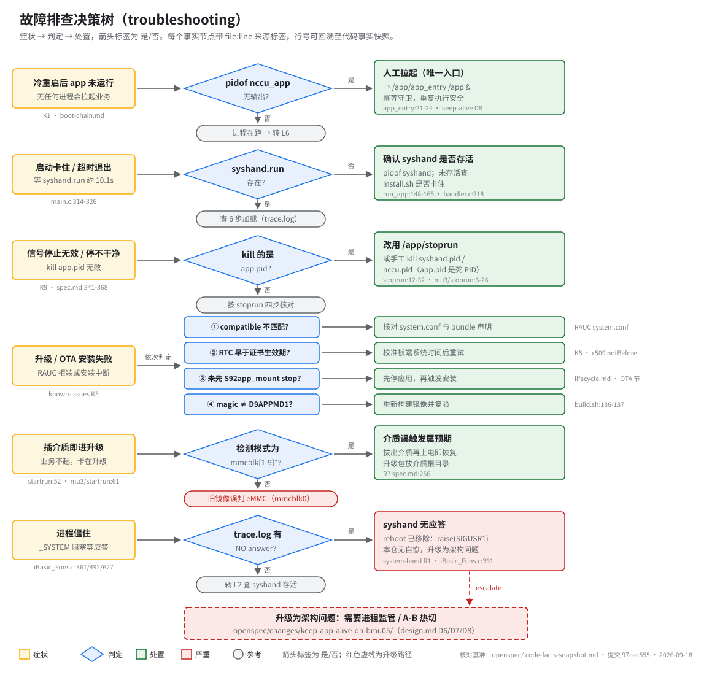

# 故障排查决策树（Troubleshooting）

> **性质**：操作手册
> **需求权威源**：`openspec/specs/app-lifecycle/spec.md`（R7/R8/R9/R12–R14）+ `openspec/specs/system-hand/spec.md`（R1/R5）
> **代码事实基线**：`openspec/.code-facts-snapshot.md`
> **对应提交**：`97cac555`
> **状态**：🟠 部分

## 读图



先读图再动手：六个症状各一条「症状 → 判定 → 处置」链，箭头上的 是/否 是判定结果，红色虚线是升级路径（escalate）。图中每个事实节点带 `file:line` 来源标签，可回溯到代码事实快照；与正文行号冲突时以快照为仲裁。

> 排查前先确认平台变体：`cat /etc/hostname`。`MU_TYPE=mu3` 构建实际安装 `src/shells/mu3/*`（app-lifecycle R12），mu3 与非 mu3 的脚本行号在文中分列。

## 症状 1：冷重启后 app 不启动

- **判定**：`pidof nccu_app` 无输出，且设备刚经历冷重启。
- **根因**：boot 路径启动责任真空——`S92app_mount` 只挂载不启动（其 `run_app()` 定义后从未被调用，snapshot `:226-229`），app_sysmgr v2 已移除启动能力；唯一自动启动者是 OTA 安装（app-post-install）。
- **处置**：人工拉起 `/app/app_entry /app &`。唯一入口，boot 与 OTA 共用；幂等守卫（`app_entry:21-24`），重复执行安全。
- **依据**：`docs/10-architecture/boot-chain.md`、`keep-app-alive-on-bmu05/design.md` D8、known-issues K1。

## 症状 2：启动卡住 / 超时

- **判定**：`/opt/appdata/data/syshand.run` 是否出现。nccu_app 启动后轮询它，约 10.1s 超时（101 × 100ms，`main.c:314-326`）。
- **否（未出现）**：查 syshand 存活 `pidof syshand`；未存活则查 `/app/extensions/install.sh` 是否卡住（run_app 等它退出，`run_app:148-165`）。`syshand.run` 每次启动由 syshand 重建（`handler.c:218`），残留无害。
- **是（已出现）**：转 `trace.log` 查 6 步模块加载（`main.c:147-202`，app-lifecycle R8），定位首个失败步骤。
- **依据**：system-hand R5——run_app 存活检查非 mu3 双重条件（`run_app:168-179`）、mu3 仅查进程（`mu3/run_app:122-132`）。

## 症状 3：stoprun 停止不干净 / 信号停止无效

- **判定**：是否在 kill `/var/run/app.pid` 指向的进程，或依赖 `S92app_mount stop`。
- **是（无效属预期）**：app_entry 是非驻留脚本，SIGTERM trap 不可达、app.pid 是死 PID（app-lifecycle R9，`spec.md:341-368`）。
- **处置**：改用 `/app/stoprun`；脚本不可执行时的等价手工序列（顺序与行号 `stoprun:12-32`、mu3 `mu3/stoprun:6-26`）：

  ```sh
  killall -9 app_update
  killall -9 nccu_ui_mm        # mu3 设备（如 bmu05）改用: killall -9 nccu_ui
  kill "$(cat /opt/appdata/data/syshand.pid)" 2>/dev/null
  kill "$(cat /opt/appdata/data/nccu.pid)" 2>/dev/null
  ```

- **验证**：`pidof nccu_app; pidof syshand` 均无输出；`ls /opt/appdata/data/*.pid` 为空。

## 症状 4：升级失败（RAUC 拒装 / 安装中断）

依次判定四项，命中即处置：

| # | 判定 | 处置 | 依据 |
|---|---|---|---|
| 1 | `compatible` 与设备不匹配 | 核对 RAUC `system.conf` 与 bundle 声明 | RAUC system.conf |
| 2 | 板端 RTC 未同步（时钟早于证书 notBefore） | 校准系统时间后重试安装 | known-issues K5 |
| 3 | 未先停应用 | 先 `S92app_mount stop` / stoprun，再触发安装 | lifecycle.md「OTA 安装路径上的启停」 |
| 4 | app.img 尾部 magic ≠ `D9APPMD1` | 镜像损坏：重新构建并复验 | `build.sh:136-137` |

- K5 机制成立但仓内无实证记录（⚠️ 标注），真机复现后补充证据。

## 症状 5：插入介质误触发升级

- **判定**：startrun 的介质检测模式是否为 `/dev/mmcblk[1-9]*`（`startrun:52-53`、`mu3/startrun:61-62`）。
- **是（模式正确）**：插着 U 盘/SD 上电进入 `app_update` 属设计行为，业务不起。拔出介质再上电即恢复；确需升级时把升级包放介质根目录（app-lifecycle R7）。
- **否（旧镜像）**：2026-07 前的 `ls /dev/mmc*` 把内置 eMMC（`/dev/mmcblk0`）误判成 SD 卡，卡死在 app_update（修正注记 `spec.md:256`）。升级到修正后的镜像。

## 症状 6：进程僵住（`_SYSTEM` 阻塞）

- **判定**：`trace.log` 是否出现 `HEARTBEAT NO answer` / `CMD[...] NO answer, need restart system`。
- **是**：syshand 对系统命令代理无应答（客户端等待超时 `_SYSTEM_LOCK_WAIT_TIMEOUT=30000ms`，三个现场 `iBasic_Funs.c:361/492/627`）。该路径的 `system("reboot")` 已移除，兜底是 `raise(SIGUSR1)`。
- **本仓无自愈**：此场景属进程监管 / A-B 热切范畴——升级为架构问题（见下方升级路径）。syshand 心跳丢失 180s 亦仅记录并继续服务（system-hand R1，`handler.c:114-125`）。
- **依据**：publib syshand 客户端 SDK（`_SYSTEM`/`Do_Proc_HeartBeat`）、system-hand R1。

## 升级路径（escalate）

> 🔴 **升级为架构问题**：凡症状 1/3/6 暴露出「需要进程监管、崩溃自愈、A-B 热切」的场景，本仓不再就地修补——方案与决策记录见 `openspec/changes/keep-app-alive-on-bmu05/`（design.md D6/D7/D8）。

## 相关文档

- 启停操作细节：[`lifecycle.md`](lifecycle.md)
- 日志与数据文件：[`logs-and-db.md`](logs-and-db.md)
- 启动链归因：[`../10-architecture/boot-chain.md`](../10-architecture/boot-chain.md)
- 已知问题索引：[`../90-reference/known-issues.md`](../90-reference/known-issues.md)
