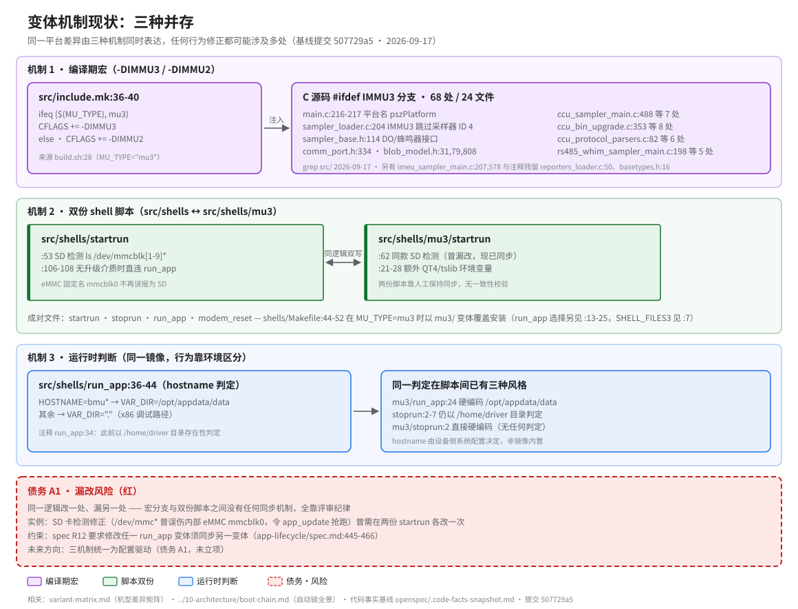

# IMMU3 → BMU05/EMU01 迁移：变体机制历史遗留

> **性质**：叙述性文档
> **需求权威源**：`openspec/specs/app-lifecycle/spec.md`（R12）
> **代码事实基线**：`openspec/.code-facts-snapshot.md`
> **对应提交**：`507729a5`
> **状态**：🟠 部分

## 现状图

读图指引：三条横带各对应一种机制（紫 = 编译期宏，绿 = 脚本双份，蓝 = 运行时判断），红色虚线带为"同一逻辑改一处、漏另一处"的结构性风险。

## 历史背景

- 本代码库源自 IMMU3 机型，BMU05 / EMU01 是在其基础上移植的新平台，迁移**未完成**。
- 移植采取的是"叠加变体"而非"替换平台"：IMMU3 的痕迹同时保留在编译宏、脚本副本和运行时判断三层，三层互相独立，没有单一事实源。
- 当前一次构建只落在一个分支上：`build.sh:28` 写死 `MU_TYPE="mu3"`，出厂产物走 mu3 路径——`src/include.mk:36-40` 据此注入 `-DIMMU3`，`src/shells/Makefile:44-52` 据此安装 mu3 脚本变体。
- 换言之：仓库里同时存在 IMMU3 遗留、mu3 变体与非 mu3 主线三套表达，而磁盘上的镜像只体现其中一条路径；未走到的路径没有构建产物验证，属于"静默腐化区"。

## 三种机制并存的具体位置

1. **编译期宏**
   - 定义点：`src/include.mk:36-40` —— `MU_TYPE=mu3` → `-DIMMU3`，否则 `-DIMMU2`。
   - 消费点：C 源码 `#ifdef IMMU3` 共 **68 处 / 24 文件**（grep `src/`，2026-09-17）。
   - 密集区：
     - 采样器：`sampler_loader.c:204`（IMMU3 跳过采样器 ID 4）、`sampler_base.h:114`（DO/蜂鸣器接口）、`ccu_sampler_main.c:488` 等 7 处、`ccu_bin_upgrade.c:353` 等 8 处、`ccu_protocol_parsers.c:82` 等 6 处、`rs485_whim_sampler_main.c:198` 等 5 处、`imeu_sampler_main.c:207,578`。
     - 公共头：`comm_port.h:334`、`blob_model.h:31,79,808`。
     - 入口侧：`main.c:216-217`（平台名 `pszPlatform = "IMMU3"`）。
   - 注释残留：`reporters_loader.c:50`、`basetypes.h:16`（宏定义已被注释，仍可佐证历史）。
2. **双份 shell 脚本**
   - 成对文件：`startrun`、`stoprun`、`run_app`、`modem_reset` —— `src/shells/` 与 `src/shells/mu3/` 各一份（`SHELL_FILES3` 见 `src/shells/Makefile:7`）。
   - 安装规则：`src/shells/Makefile:44-52` 在 `MU_TYPE=mu3` 时以 mu3 变体覆盖安装；`run_app` 的选择逻辑在 `:13-25`（另分 debug/release 两档）。
   - 差异示例：mu3 版 `startrun:21-28` 额外导出 QT4/tslib 环境变量；主版 `startrun:17` 的库搜索路径多含 `extensions`。
3. **运行时判断**
   - 判定点：`src/shells/run_app:36-44` —— `hostname` 前缀 `bmu*` → `VAR_DIR=/opt/appdata/data`，其余 → `"."`。
   - 历史形态：以 `/home/driver` 目录存在性判定，注释保留于 `run_app:34`，`stoprun:2-7` 仍在使用该判定。
   - 变体形态：`mu3/run_app:24` 与 `mu3/stoprun:2` 直接硬编码 `/opt/appdata/data`，无任何判定。

## 已知的"双份脚本漏改"实例

- **SD 卡检测误报**（已修复）：
  - 现象：两份 `startrun` 原以 `ls /dev/mmc*` 判 SD 卡，命中内部 eMMC 固定设备名 `mmcblk0`，无 SD 卡时也进入升级分支，`app_update` 抢跑导致 `nccu_app` 不启动。
  - 修正：收紧为 `ls /dev/mmcblk[1-9]*`（`startrun:53`、`mu3/startrun:62`），并移除无升级介质时的 `app_update` 调用（`startrun:106-108` 及 mu3 对应分支）。
  - 代价：同一处逻辑修复需在两份脚本各改一次——双份脚本无同步机制的直接体现。
- **run_app 变体失同步**（历史，促成 R12 立规）：
  - 现象：早期修复只做在主 `run_app`，mu3 版缺 `LD_LIBRARY_PATH` 的 `/app/extensions` 路径、仍向 `/usr/lib` 拷贝 `.so`、以 PID 文件判定 syshand，应用启动即退。
  - 记录：背景见 `app-lifecycle/spec.md:455`；此后 R12（`spec.md:445-466`）固定了"改任一变体须同步另一变体"的核对项。

## 为什么暂不改

- 当前首要约束是**先保证 app 在 BMU05 / EMU01 上跑起来**：app 分区、启动链、进程监管等问题优先级更高（见 `docs/10-architecture/boot-chain.md`）。
- 三层机制虽冗余，行为已被 R12 的同步要求约束住；在启动链闭环前重构变体机制，只会引入新的回归面，且现有零测试基线（`openspec/.code-facts-snapshot.md`）无法兜底。
- 现阶段方向是**标记而非拆除**：跨变体修改按 R12 在两个变体上同步并核对；新代码不新增 `#ifdef IMMU3` 分支与新的脚本副本。

## 若未来配置化

- 可能方向：以一份设备描述（配置文件或内核提供的机型标识）驱动全部差异点——脚本只读配置不再分叉，`#ifdef` 收敛到极少数真正的编译期差异（如外设寄存器布局）。
- 迁移路径大致为：先冻结双份脚本（R12 核对项自动化）、再把 VAR_DIR/平台名等环境判定改为读配置、最后逐文件消化 `#ifdef IMMU3`。
- 收益是把"改一处、漏另一处"的结构性风险消除；代价是一次跨采样器 / 构建 / 脚本的横切改造，需要测试基线先行。
- 此项即债务 A1，**未立项**，此处仅记录方向，不构成承诺。

## 相关文档

- `variant-matrix.md` —— 机型差异矩阵（OS / 内核 / 分区 / 脚本变体 / 编译宏）。
- `../10-architecture/boot-chain.md` —— 启动链全景（本文涉及的脚本均在其链路上）。
- `openspec/specs/app-lifecycle/spec.md` R12 —— 双变体一致性要求的权威表述。
