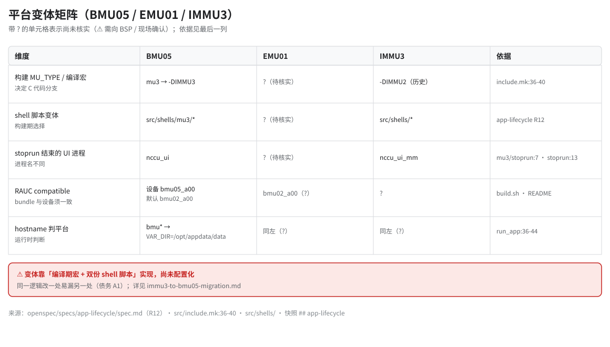

# 平台变体矩阵

> **性质**：叙述性文档（读图指引 + 扩展说明）
> **需求权威源**：`openspec/specs/app-lifecycle/spec.md`（R12）+ `openspec/config.yaml`
> **代码事实基线**：`openspec/.code-facts-snapshot.md`
> **对应提交**：`d4b0055b`
> **状态**：🟠 部分（矩阵含 ⚠️ 待核实项）

## 图

## 有哪些变体

- **BMU05**：当前主用机型，构建走 `MU_TYPE=mu3`，即 `-DIMMU3` 与 `src/shells/mu3/*` 变体脚本。
- **EMU01**：与 `bmu02` 的 compatible 有交集，具体对应关系 ⚠️ 待与 BSP / 现场确认（见矩阵中的 `?`）。
- **IMMU3**：历史平台，非 mu3 分支（`-DIMMU2` + `src/shells/*`），代码与脚本中仍有其痕迹。

## 三种差异机制

1. **编译期宏**：`include.mk:36-40` 依 `MU_TYPE` 追加 `-DIMMU3` 或 `-DIMMU2`，C 代码内以 `#ifdef` 分叉。
2. **双份 shell 脚本**：`src/shells/` 与 `src/shells/mu3/` 成对存在，构建时按 `MU_TYPE` 安装其中一份。
3. **运行时判断**：`run_app:36-44` 用 hostname 推导 `VAR_DIR`，属运行时而非构建期差异。

## 为什么这是债

同一逻辑要在"编译宏 / 两份脚本 / 运行时判断"三处保持同步，**改一处漏另一处**是必然风险。已有实例：SD 卡误检修正与 `app_update` 分支曾需要在两份 `startrun` 同步。

## 待核实

- EMU01 的 `MU_TYPE`、shell 变体、hostname：矩阵中标 `?`。
- IMMU3 的 RAUC compatible 与是否仍在维护：矩阵中标 `?`。
- 上述项需向 BSP / 现场确认后回填，并更新本文「对应提交」。
