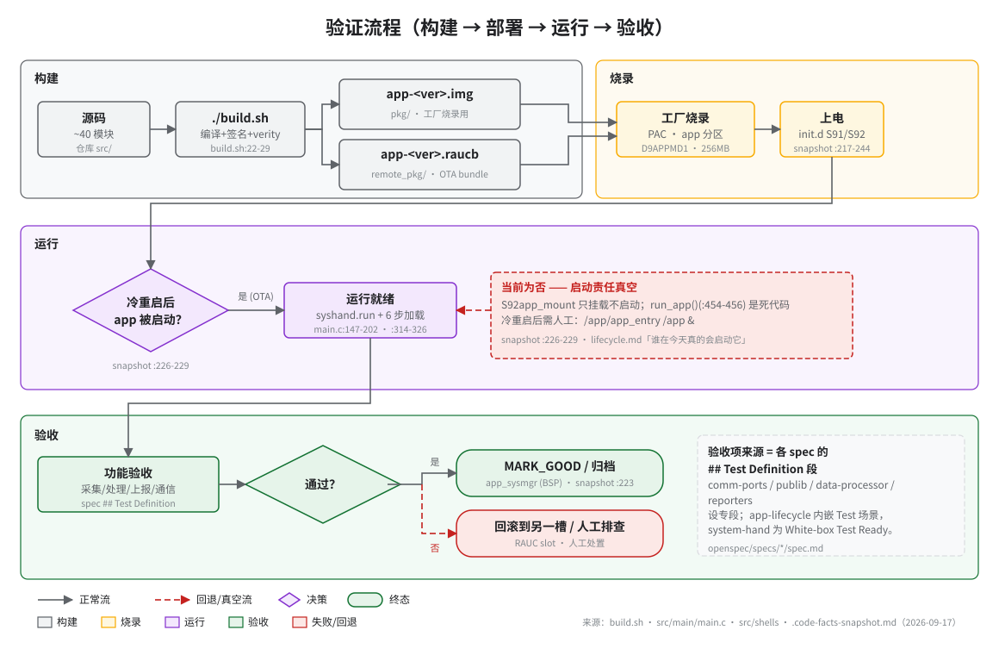

# 发布前验收清单

> **性质**：操作手册
> **需求权威源**：`openspec/specs/<capability>/spec.md` 共 7 个 spec 的 `## Test Definition` 段
> **代码事实基线**：[`openspec/.code-facts-snapshot.md`](../../openspec/.code-facts-snapshot.md)
> **对应提交**：`507729a5`
> **状态**：🟠 部分

本页回答两个问题：发布前**逐项检查什么**、每项**依据哪个 spec**。流程全貌见上图；验收时按子系统分组勾选，全部通过后方可归档。

来源注记：comm-ports / publib / data-processor / reporters 四个 spec 设有专段 `## Test Definition`；app-lifecycle 的验收语义在内嵌 `##### Test:` 场景与各 R；system-hand 以 `## White-box Test Ready` 标记单测不可行、走真机集成；samplers 无专段，按加载与数据闭环验收。本文只列运行时检查项，验收级断言回溯各 spec 的 `R<n>`。

## 发布前验收清单

### app-lifecycle（构建—烧录—启动，[spec](../../openspec/specs/app-lifecycle/spec.md)）

- [ ] 构建产物齐备：`pkg/app-<ver>.img` 与 `remote_pkg/app-<ver>.raucb`，文件名含 git 版本号（R2/R5）
- [ ] `dumpe2fs -h pkg/app.ext4` 的 Block size = 4096（R3）
- [ ] `pkg/verity_info.txt` 含 Root hash，参数 sha256 / 4096（R4，`config/verity.conf`）
- [ ] app.img 尾部 8 字节 magic = `D9APPMD1`（R5，`build.sh:136-137`）
- [ ] RAUC manifest `compatible=bmu02_a00` 与设备端配置一致（R6，`build.sh:27`）
- [ ] 设备端 `cat /var/lib/rauc/slot-status | grep bundle.version` 与构建版本一致（R2 Test: 设备端版本查询）
- [ ] mu3 与非 mu3 两套变体行为一致（R12，`src/shells/` 与 `src/shells/mu3/`）
- [ ] 启动链完整：syshand 拉起 → `syshand.run` 就绪 → 6 步加载全部完成（R8，`main.c:147-202`、`main.c:314-326`）
- [ ] nccu_app 以生产模式直接启动，无 strace 包装（R13）

### comm-ports（[spec](../../openspec/specs/comm-ports/spec.md) Test Definition R1–R12）

- [ ] R1：9 个模块头文件的 6 个 HAL 别名宏齐全，typedef 与 `comm_port.h:284-291` 一致
- [ ] R10：`comm_loader` dlopen/dlsym 加载 9 个 .so；dummy 端口跳过、符号缺失按定义处置
- [ ] R11：`COMM_CONTROL` 各命令的参数校验生效
- [ ] R12：`CommGetLastError` 首字段 `nLastErrorCode` 约束保持
- [ ] R2–R9：协议层（CAN/TCP/UDP/双 WebSocket 实现/HTTP-FTP/IPC/RPMSG/Serial）按 Test Definition 的 mock/真机策略逐项核验

### publib（[spec](../../openspec/specs/publib/spec.md) Test Definition R1–R9）

- [ ] R1/R5/R8/R9：纯逻辑可测项（队列、内存池泄漏、栈宏、工具函数）按 Test Definition ✅ 行完成
- [ ] R6：运行时生成三个 DB 锁文件 `.{applog,bmsrundata,clouddata}.lock`（`iDataBase.c:34/39/44`）
- [ ] R7：syshand 客户端 SDK 的 System V IPC 配对经真机集成核验
- [ ] R2：`/opt/appdata/log/trace.log` 有日志输出

### system-hand（[spec](../../openspec/specs/system-hand/spec.md)，单测不可行 → 真机集成）

- [ ] syshand 启动并写 PID 文件与 `syshand.run` 标记（R5，`handler.c:218`）
- [ ] 命令分发 iCmdType 0/1/99 三路可用（R2，`handler.c:139-152`）
- [ ] 心跳丢失 180s：仅写 `no reboot, no exit` 日志并继续服务（R1，`handler.c:114-125`）
- [ ] `## White-box Test Ready` 为否的结论仍成立，集成验证覆盖其场景

### data-processor（[spec](../../openspec/specs/data-processor/spec.md) Test Definition R1–R7）

- [ ] R1：配置自 SQLite `/app/config/System.cfg` 加载（非 INI，`config_mangmt.c`）
- [ ] R2/R3：事件派发与告警状态机（ACTIVE→CEASED/SUPPRESSED）按 Test Definition 核验
- [ ] R4：`Exp_Calculate` 表达式引擎端到端通过（✅ 可测项）
- [ ] R7：四个 DB 位于 `/data/` 顶层（`NCCU_DATA_PATH`），不在 `/opt/appdata/data`（snapshot `:116-123`）

### samplers（[spec](../../openspec/specs/samplers/spec.md)，无专设测试段 → 加载与数据闭环）

- [ ] 10 个编译内采样器全部加载成功（snapshot `:299-316`，`src/Makefile:36-47`）
- [ ] 4 个导出符号 Initialize/Sample/Control/JigTest 齐备（`sampler_base.h:68-77`）
- [ ] 条件加载跳过正确：IMMU3 跳 ID4 / SEMS 跳 4–6 / 非 AEMS 跳 9（`sampler_loader.c:180-232`）
- [ ] 采样值进入 DPR 并可被上报器读取（数据闭环，R8）

### reporters（[spec](../../openspec/specs/reporters/spec.md) Test Definition R1–R12）

- [ ] 8 个 reporter 加载，nPlatformType 条件跳过 6/7/8/9 符合矩阵（R1，`reporters_loader.c:36-113`）
- [ ] 唯一导出符号 Initialize 存在（`reporters_base.h:27`）
- [ ] R2 MQTT / R3 英飞源云 / R4 Modbus 消息格式与重连按 Test Definition 核验
- [ ] R6–R9（IEC 104/101/61850/OCPP）未编译 → 标记为本次验收排除项

## 验收前置

- 设备可达且有 root shell（串口或 SSH），`/etc/hostname` 确认变体，mu3 设备走 `src/shells/mu3/*` 行号对照（[lifecycle.md](../60-operations/lifecycle.md)）。
- 设备时钟已同步（NTP）：RAUC 验签与元数据校验依赖正确时间。
- 上电前拔掉 USB/SD 介质，避免误入 `app_update`（`startrun:52-53`、`mu3/startrun:61-62`）；升级前先停旧实例（`S92app_mount stop`，R9 注记）。
- 构建期签名服务器可达（`http://192.168.34.207:8900`，`build.sh`），否则在线签名失败。

## 已知阻断

- 冷重启后启动责任真空：`S92app_mount` 只挂载不启动（snapshot `:226-229`）。验收启动走 OTA 安装钩子，或人工 `/app/app_entry /app &`。
- 停止链不可达：`/var/run/app.pid` 是死 PID（R9）。验收中停应用用 `/app/stoprun`，勿依赖 kill PID。
- 无崩溃自愈：nccu_app 崩溃后无人拉起。验收中断时人工重启并保留现场（`/opt/appdata/log/trace.log`）。
